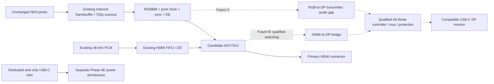

# Phase 6F — USB-C video feasibility and architecture qualification

## Executive decision

**DEFER onboard USB-C video. Keep HDMI primary and the separate Phase 6E
sink-only USB-C power inlet.** Native DP on the proposed Cyclone V SE is
**NO-GO**. External conversion is technically plausible (**CONDITIONAL GO for
an evaluation prototype**), but no complete DP/audio/Type-C component chain is
production-qualified. This is an architecture/model phase, not a production
PCB or physical compliance result. The DE1-SoC is unavailable; all physical
video, sound, latency, power and thermal results are **NOT TESTED**.

The selected production candidate remains **5CSEMA5F31C6N** from
`config/phase6a_architecture.json`; the existing Quartus target is
`5CSEMA5F31C6`. No game logic, RTL, board pins, clocks, SDC, MMIO registers or
Phase 6E power policy change. Phase 6G is not started.

The machine-readable evidence is
[`config/phase6f_usbc_video.json`](../config/phase6f_usbc_video.json).
`verification/usbc_video.py` validates its versioned schema and arithmetic.
Null cost/power values mean **unknown**, never zero. Component **VERIFIED**
would mean the stated qualification scope has evidence, not merely a public
product page. **PROVISIONAL**, **DOCUMENTATION RESTRICTED**, **UNAVAILABLE** and
**REJECTED** are separate states. No candidate chain earns VERIFIED here;
missing stock evidence is not proof a part is unavailable.

## Repository gate and baseline

Entry branch `phase6/usbc-video`, HEAD `e2fd591`, history containing that commit,
clean tracked/untracked status, and origin
`git@github.com:hhashmi4/nintendo-fpga.git` all passed. The existing Phase 5K,
5M and 6A–6E documents, actual module interfaces, QSF/SDC and test scripts were
inspected before editing. Both baseline commands exited zero:

```bash
PATH="$PWD/.venv/bin:$PATH" scripts/test.sh
PATH="$PWD/.venv/bin:$PATH" scripts/build_de1_soc_nes_vga_quartus.sh
```

The baseline passed **2,117 Python tests**, complete Verilator lint and the
complete RTL/model/debugger regressions. This includes 5K audio, 5M
MMIO/diagnostics, 6B video, 6C HDMI, 6D audio, 6E power, CPU/PPU/APU/DMA,
controllers, Mapper 0, loader/microSD software, VGA, Developer Mode and
playable-ROM coverage. No physical microSD or board test is inferred.
Logs are ignored artifacts under `build/phase6f/baseline-tests.log` and
`baseline-quartus.log`; baseline fit and timing summaries were copied before
rebuilding. Per-suite cycle counts are reported below, not summed across
nested/overlapping tests.

## Existing architecture and FPGA capability audit

| Existing module or interface | Actual contract / implication |
|---|---|
| `nes_core` | Original 256x240 pixel stream, color/emphasis, `pixel_valid`, `pixel_x/y`; 50 MHz fabric with NES clock enables. Gameplay timing stays independent of displays. |
| `nes_framebuffer` | Three 256x240x9 indexed banks, 1,658,880 logical bits, 204 M10Ks; complete-frame ownership crosses by held bundle/toggle. One scanout read contract. |
| `nes_digital_video_pipeline` | `source_clk`, `source_frame_start`, `source_pixel_valid/x/y/color/emphasis`; pixel-domain `rgb[23:0]`, `hsync`, `vsync`, `active_video`, `video_pixel_clock`, `frame_start/end`, `line_start/end`. Palette expansion follows the memory read. |
| `video_720p_timing`, `nes_720p_scaler` | 1650x750 total, 1280x720 active; full NES image in centered 960x720 canvas, exact 3x vertical, deterministic nearest-neighbor horizontal mapping; Developer Mode preserved. |
| `video_720p_pll` | Requests 50 MHz ×297/200 = 74.25 MHz; prior fitted 6D target realizes ×49/33 = 74.242424 MHz, −102.03 ppm, 59.993878 Hz. Nominal bandwidth tables are not fitted-clock measurements. |
| `phase6c_hdmi_top`, `hdmi_tx_controller`, `hdmi_rgb_output` | Logical `HDMI_PCLK/RGB/HSYNC/VSYNC/DE`, `HDMI_HPD`, open-drain I2C and `HDMI_PD`; documented ADV7513 profile and EDID/HPD gating. Virtual pins, no board HDMI. |
| `nes_audio_output` | Phase 5K signed-16 mono `pcm_output_sample`, `pcm_output_valid`, `pcm_output_reset`, `hdmi_audio_clk`; source at 48 kHz. |
| `phase6d_hdmi_audio_top`, `hdmi_audio_transport`, `hdmi_i2s_tx` | Independent 32-entry FIFO; duplicate PCM to stereo; 32-bit slots, 3.072 MHz mean BCLK, 48 kHz LRCLK. ADV7513 does HDMI packetization. |
| `audio_pll` | 12 MHz WM8731 output; optional 50 MHz HDMI output from same PLL. Production uses two FPGA PLLs total; standalone HDMI/audio also two. No DP reference clock allocated. |
| `nes_hps_loader_system` | Independent HPS user clock 97.368421 MHz, HPS DDR and microSD; not a GPU/DP PHY. |
| `nes_diagnostic_subsystem` | Atomic snapshot/mailbox at `0xff201000`, 512 bytes, MMIO v1.3; HDMI and USB-C physical availability false in production. |
| `phase6e_power_top` | Separate virtual-port, post-configuration observer, not a PD controller or power switch. |
| `de1_soc_nes_vga_top` | Actual production target: VGA/WM8731 and existing HPS interfaces; no USB-C video pins or external bridge. |

Altera's device-variant table distinguishes SE from transceiver-equipped
SX/ST [fpga]. The SE A5/F896 package has GPIO, not HSSI lanes [fpga_package].
**Zero native DP lanes, no native DP PHY or hardened DP controller.** GPIO
LVDS family limits (840 Mbit/s transmit) do not meet even 1.62 Gbit/s RBR and
do not supply DP electrical behavior [fpga_io]. A new PCB cannot expose
transceivers absent from the die. The N ordering suffix does not change this.

Altera has DisplayPort IP, AUX/control and training support [dp_training], but
IP existence for a device family does not qualify this SE/package/toolchain.
No DP IP is instantiated or licensed in the repository. Fabric GPIO could
carry low-speed control to an **external** transmitter with appropriate
level/analog interfaces; it is not itself a compliant AUX PHY. No suitable
DP link PLL/reference-clock input/output chain is implemented. A transmitter
must furnish its own qualified link clock; an FPGA pixel PLL cannot substitute
for it. Two or four Type-C high-speed pairs require a real DP PHY, mux and
orientation mapping; a one-lane DP capacity calculation does not by itself
select a valid Type-C pin assignment.

Production SDC retains the 20 ns fabric clock, generated VGA/audio clocks,
asynchronous domain groups, first-stage synchronizer exceptions and finite
mailbox bundle delays. Phase 6D has a forwarded/inverted HDMI capture clock
and source-synchronous output delays. None are relaxed or reused as proof of
DP timing. Custom PCB I/O banks and pins require a new package/power/timing
review, independent of DE1-SoC wiring.

## USB-C / DP requirements and ownership

| Term | What it supplies |
|---|---|
| USB-C | Reversible connector/cable and attach/orientation/current-advertisement behavior. It does not imply video. |
| USB PD | CC messaging and power/data-role policy; also the structured VDM framework for Alt Modes. |
| USB data | USB packet transport. USB 2/3, USB4 tunneling and DP Alt Mode are distinct capabilities. |
| DP Alt Mode | Negotiated assignment of Type-C pairs to native DP transport. It does not convert HDMI into DP. |
| DisplayPort | Main-link video/audio transport plus AUX, capability discovery and link training. |
| HDMI | Different video/audio transport, signaling and sink-control path. Conversion to DP is active. |

The public TI flow [altmode, pp. 3–8, 14–16] describes PD negotiation followed
by identity/SVID/mode discovery, Enter Mode, DP Status Update and Configure.
VESA SVID is **0xFF01**. Compatible source/sink roles and pin assignments must
intersect before configuration. ACK of Enter Mode is not evidence of a trained
DP link. HPD level and IRQ travel in DP status/attention signaling over CC;
AUX uses SBU1/2 and the main link uses selected high-speed pairs [vesa].

A future controller/firmware owns CC1/CC2 terminations, attach debounce,
orientation, structured VDM exchanges, role policy, cable identity/capability,
VCONN supply/swap policy and mux-safe sequencing. Rp/Rd and current limits
must match the negotiated power role; VBUS stays protected and controlled
through attach/detach [typec_tests]. VCONN powers cable electronics, not the
monitor. E-marker speed/current data and active-cable capabilities matter;
a charging/USB2-only cable is not a qualified video cable [pd_intro]. Both
plug orientations need the correct main-lane and AUX polarity maps.

The external DP transmitter owns AUX DPCD access, EDID over AUX, selection of
supported lane count/rate, clock recovery and channel-equalization training,
scrambling/stream formatting, link monitoring and audio packets [dp_training,
dp_audio]. HPD IRQ requires status service; it must not pass through the
existing HDMI 5 ms debounce as though it were a slow disconnect. A normalized
report adapter must translate controller-specific behavior into policy state.

Public presentations/application notes are architecture evidence, **not a
complete protocol specification**. Current USB-IF listings identify Type-C
2.5 and PD 3.2 v1.2; only their publication pages were retrieved. The full
normative VESA DP and DP Alt Mode specifications were not obtained; VESA
membership/licensing access remains a gate [vesa_access]. No new timer values,
VDM payloads, AUX register programming or conformance rules are invented here.

## Architecture comparison

All cost/power comparisons are incremental to HDMI-only A. An unknown quote
is not an estimate of zero. A and E add zero **internal DP BOM** by definition;
HDMI and the original power design still cost money.

| Option | Feasibility, FPGA and bandwidth | Audio, clocks, interfaces and firmware | Product/qualification judgment |
|---|---|---|---|
| **A HDMI-only** | Matches existing RGB888 → ADV7513 boundary; current scanout only 720p. | Existing PCM/I2S and I2C/EDID/HPD; no new Linux display stack. | **CONDITIONAL GO** for custom HDMI prototype, pending existing physical gates. Lowest incremental routing, power, thermal and support burden. |
| **B HDMI → DP → USB-C** | Real LT6711A candidate; current 165 MHz HDMI transmitter and 720p scanout remain upstream limits. Need switch/distribution for HDMI connector plus bridge. | Receive HDMI audio and repacketize DP; 27 MHz bridge crystal. Integrated controller/mux may replace discrete functions after qualification. Vendor firmware/registers and EDID/HPD behavior unresolved. | **CONDITIONAL GO** for evaluation only. Extra high-speed HDMI and DP routing, firmware, power and interoperability burden. Full peak power and BOM quote unknown. |
| **C RGB → separate HDMI + DP TX** | ANX9807 matches 24-bit SDR input and offers two HBR2 lanes. Same-clock RGB fanout possible subject to loading/skew; independent rates need memory/read-port work. | DP-side PCM/I2S acceptance **not documented** in brief: audio blocks qualification. Separate PD controller/mux, AUX and crystal details needed. HPS or controller firmware integration required. | **CONDITIONAL GO**, stronger documentation/audio gaps than B. Avoids HDMI conversion stage but adds RGB fanout, DP PHY routing and many controls. Low published chip power is not a system budget. |
| **D native-DP SoC** | Zynq UltraScale+ MPSoC has hardened PS DP and PS-GTR path [zynq]; not equivalent to Zynq-7000 or this Cyclone V. Exact part/package remains unselected. | Native live-video/audio or framebuffer interfaces, dedicated video PLL; still needs Type-C policy/mux/protection. New tools, boot/DDR, MMIO, pinout and Linux/firmware qualification. | **NO-GO for this phase/product baseline**. Technical route exists, but migration cost, thermal/power budget, licensing, availability and verification dominate the optional feature. No new resource/cost claim. |
| **E HDMI + user converter** | Manufacturer documents Club 3D CAC-1333 in the needed HDMI-source → USB-C-display direction [adapter]. Passive or reverse-direction cables do not work. | Its sheet requires a self-powered display and specifies adapter power from USB-C, 5 V/500 mA max. Exact 720p stereo-audio interoperability still untested. | **CONDITIONAL GO** as optional user accessory, not a bundled compatibility promise. No additional console PCB heat/layers; adapter purchase/power/support burden moves outside console. |

For B, HDMI TMDS cannot be passively Y-split to two sinks. Exclusive selection
needs a qualified switch with DDC/HPD ownership; simultaneous output needs
active distribution and a compatible common mode/EDID policy. Neither is
implemented. C can share one 720p raster between two input-compatible
transmitters, but that is not two independently negotiated resolutions.
A second triple store would need about **479 M10Ks versus 397 available**.
VGA at 25.2 MHz plus HDMI/DP at another rate needs safe shared-bank reader
ownership, prefetch/line buffering or external memory. Phase 6F creates none.

A complete chain must prove video, audio, hot-plug, configuration recovery,
source/sink power roles and firmware redistribution rights. Public marketing
limits are not procurement, lifecycle or interoperability guarantees.



Dashed paths are architecture alternatives, not fitted hardware. Integrated
bridge control/mux functions may absorb blocks only after qualification.

## Component qualification

Full per-candidate metadata, source revisions and unknowns are in JSON. The
following are commercially documented candidates, **not a selected BOM**.
No stock levels or numeric prices were available from a dated authorized quote.

| Manufacturer / exact candidate | Published function and limits | Supply / clock / control / package | Qualification and missing evidence |
|---|---|---|---|
| Analog Devices **ADV7513BSWZ** | RGB888/I2S → HDMI; 165 MHz, 1080p; multichannel LPCM [adv7513 Rev. B]. | 1.8/3.3 V; input pixel clock, selected I2S mode needs no MCLK; I2C; LQFP64. | **PROVISIONAL** existing candidate. Physical behavior/procurement still open. |
| Analogix **ANX9807** | 24-bit SDR or 18-bit DDR LVCMOS → DP1.2/eDP, two RBR/HBR/HBR2 lanes, up to 270 Mpixel/s. Brief literally prints 2500x1600@60; do not silently correct it. Audio unspecified [anx9807]. | 1.2/2.5 V, <210 mW QXGA operating point; I2C; 81-ball 8x8 mm BGA, 0.8 mm pitch. XTAL shown but frequency/tolerance unavailable. | **DOCUMENTATION RESTRICTED**: public brief only; full manual, audio, electrical timing, lifecycle, reference clock and external-DP use unresolved. |
| Lontium **LT6711A** | HDMI2 → DP1.2/eDP1.4; four lanes through HBR2, 4K60 and eight sound channels advertised; integrated Type-C switch/PD [lt6711 Rev.1.1]. | 1.2/1.8/3.3 V; 27 MHz crystal; QFN64 7.5x7.5 mm; 1 W at 4K60. Full control/firmware interface unqualified. | **DOCUMENTATION RESTRICTED**: public brief marked proprietary, complete manual/firmware not obtained. Exact stereo PCM, EDID, roles, peak power, license and stock gaps. |
| TI **TPS65987D** | PD controller with DP Alt Mode and external mux control, no DP PHY/audio conversion [tps65987 Rev.D]. | 3.3 V or VBUS; I2C/GPIO; 56-pin 7x7 mm VQFN. | **REJECTED** for new design: manufacturer currently says NRND [tps_lifecycle]. TPS25751 suggestion on page explicitly lacks Alt Modes; not a substitute. |
| Infineon **CYPD3125-40LQXIT** | Programmable CCG3 Type-C/PD control; evaluation kit documents 2/4-lane mux control and HPD [ccg3, ccg3_evm]. | VSYS 3.0–5.5 V in DFP/DRP modes, separate VCONN supply budget; internal oscillator; I2C/SWD; QFN40. | **PROVISIONAL**: qualify actual DP-source firmware, tools/license, power roles, current lifecycle and stock. Not plug-and-play and not a PHY. |
| TI **HD3SS460IRHRT** | Passive orientation/mode mux including SBU; DP1.2a at 5.4 Gbit/s/lane [mux Rev.D]. | 3.3 V nominal; typical 0.6 mA active, 1.98 mW; GPIO POL/AMSEL/EN; 28-pin WQFN. No clock. | **PROVISIONAL**: package/channel eye margin and orientation mapping. No retiming or protocol conversion. |
| TI **TPD4EUSB30DQAR** | Four-conductor ESD array; published 5 Gbit/s USB target [esd Rev.G]. | Passive, no clock/control; 10-pin USON. | **PROVISIONAL**: DP channel insertion loss/capacitance must qualify. Not CC/SBU short-to-VBUS or power-path protection. More than one array may be needed. |
| ITE **IT6564FN** | DP receiver → HDMI/VGA output [reverse_bridge]. | Embedded MCU; QFN64 9x9 mm; remaining details not investigated after direction rejection. | **REJECTED**: wrong conversion direction. |

HD3SS460/ESD paths can carry audio packets transparently but cannot create
them. eDP panel support alone does not qualify an external USB-C monitor.
LT6711A's integrated functions must not be counted twice alongside a discrete
PD/mux BOM. Detailed component reference clocks, tolerances and power sequencing
remain mandatory before a schematic; unspecified values stay unspecified.

## Bandwidth and standardized modes

Definitions: `refresh = pixel_clock / (Htotal × Vtotal)`;
`active pixels/s = Hactive × Vactive × refresh`;
`active RGB = active pixels/s × 24`;
`raster RGB = pixel_clock × 24`;
`blanking fraction = 1 − active/total pixels`.
Timing identities are cross-checked against upstream Linux v6.12 DRM's
DMT/CTA tables [timings]; these are primary implementation evidence, not a
claim to have retrieved a restricted CTA standard.

| Mode / timing | Total pixels | Active Mpixel/s | Pixel clock MHz | Active / raster RGB Gbit/s | Blanking % |
|---|---:|---:|---:|---:|---:|
| 720p60, CTA VIC 4 | 1650×750 | 55.296 | 74.25 | 1.327104 / 1.782 | 25.527 |
| 1080p60, VIC 16 | 2200×1125 | 124.416 | 148.5 | 2.985984 / 3.564 | 16.218 |
| 1920×1200, DMT 0x44 RB | 2080×1235 | 138.125195 | 154 | 3.315005 / 3.696 | 10.308 |
| 2160p30, VIC 95, future reference | 4400×2250 | 248.832 | 297 | 5.971968 / 7.128 | 16.218 |
| 2160p60, VIC 97, future reference | 4400×2250 | 497.664 | 594 | 11.943936 / 14.256 | 16.218 |

DMT reduced blanking is **59.950171 Hz**, not exactly 60. A 1920×1200 panel
may accept and scale 720p, but its native dimensions do not establish that;
require EDID. Non-reduced-blanking 1920×1200 is a different timing and is not
substituted. Only 720p scanout is implemented. 1080p and 1200p need new
scanout/clock/transmitter/monitor qualification. Neither 4K mode is supported
by the current pipeline/165 MHz HDMI source. A bridge's 4K label cannot upgrade
its input.

The **256×240 NES source is not a standardized monitor mode**. Its PPU cadence
is `59062500/11 Hz`, with 341 dots ×262 lines and an odd rendered frame's
one-dot skip: average rendered refresh about **60.098814 Hz**, **3.692471
Mpixel/s** visible, equivalent RGB **88.619307 Mbit/s** after palette expansion.
The real stored samples are 9-bit indexed color/emphasis, not RGB888. The total
PPU dot rate is about **5.369318 MHz**, not the HDMI pixel clock. With rendering
disabled the skip differs; the pixel-valid stream remains authoritative.

| Per-lane raw rate | Payload after 8b/10b: 1 lane | 2 lanes | 4 lanes |
|---|---:|---:|---:|
| RBR 1.62 Gbit/s | 1.296 | 2.592 | 5.184 |
| HBR 2.70 Gbit/s | 2.160 | 4.320 | 8.640 |
| HBR2 5.40 Gbit/s | 4.320 | 8.640 | 17.280 |
| HBR3 8.10 Gbit/s, reference only | 6.480 | 12.960 | 25.920 |

Entries are Gbit/s. 8b/10b leaves 80% capacity (20% of wire capacity is coding,
or 25% overhead relative to uncoded payload). Packet/control overhead is
additional [vesa p.12]. This study conservatively screens
`ceil((raster_RGB + 1,536,000 audio bit/s) / 0.97)`. The **3% reserve is a
project assumption**, not a DP specification limit. DP does not transport
blank pixels as RGB; this raster-based calculation screens delivery rate,
not exact transport-unit packing or secondary-packet scheduling. A positive
screen still requires transmitter validation.

The resulting screens are **1.838697, 3.675810, 3.811893, 7.350037 and
14.698491 Gbit/s** respectively. 720p fits two RBR lanes; 1080p and 1200p fit
two HBR lanes; reference 4K30 fits two HBR2 lanes; reference 4K60 needs four
HBR2 lanes under this policy. No compression, chroma subsampling, MST or UHBR
is assumed. End-to-end lane/rate limits are the intersection of transmitter,
mux/channel, cable and receiver—not the largest advertised number.

## Audio and A/V coordination

DP carries audio through secondary stream audio sample, timestamp and InfoFrame
packets [dp_audio]. Reuse `nes_audio_output`'s signed-16 48 kHz mono sample,
duplicate it into two channels without a second resampler. Stereo useful
payload is **48,000×2×16 = 1.536 Mbit/s**; the existing I2S framing is
**48,000×2×32 = 3.072 Mbit/s**. Neither is a DP lane signal or full DP packet
bandwidth. The transmitter must generate DP packet framing and audio-clock
recovery metadata; HDMI N/CTS settings are not DP settings.

B must recover existing HDMI audio and convert it correctly. C must provide
a documented audio input and packetizer; ANX9807's brief does not establish
that, so video alone cannot qualify the requested audio feature. For D, AMD
publishes two-channel 24-bit/48 kHz support [zynq]; mapping the 16-bit stream
still requires integration testing.

Future contract: one-way PCM broadcast, separate asynchronous FIFO per
consumer, no backpressure into the APU, no frame-triggered sample restart.
Flush/discard old audio on detach, reset, mode reconfiguration or link loss;
prime fresh samples and unmute only after current video/link/audio capability
qualification. User mute consumes samples and sends silence. FIFO errors
mute and request recovery. HDMI/DP audio routes only to the selected, ready,
audio-capable output; VGA has no embedded audio. WM8731 remains independent.

At nominal 60 Hz there are 800 samples/frame; fitted 720p is approximately
800.081633. Do not repair that ratio by changing game/APU execution. Clock
drift, receiver audio capability, bridge buffering and monitor A/V delay need
physical testing. No measured synchronization or pop-free claim is made.

## Connector and power-role strategy

| Option | Power/data-role consequences | Recommendation |
|---|---|---|
| 1. Separate power and video USB-C | Keep STUSB4500 sink-only inlet; video port needs separate DP-source policy/controller, protected VBUS, VCONN and orientation. A fixed power-source video port can serve compatible power-sink displays, but a monitor offering power may need a different qualified role policy. | Future optional design only; clear labels and isolated power paths. |
| 2. Combined USB-C | DP data source can be a power sink; roles are independent [pd_intro]. A monitor could power the console only with a sufficient offered contract. Serving bus-powered displays as well requires source capability/DRP policy and stored/alternate energy. Dead-battery behavior, role swaps and backfeed must be requalified. | Defer. Not compatible with simply reusing sink-only STUSB4500 as an Alt Mode controller. |
| 3. USB-C power + HDMI video | Existing Phase 6E 9 V/3 A inlet and HDMI architecture. No video port's VBUS/VCONN/exported display load. | **Selected for first prototype.** |

DP source does not imply power source, and power sink does not imply DP sink.
DRP is needed when both power roles are supported, not inherently for every
DP source. USB data is optional to this proposed video function. Initial
future video qualification should target explicitly compatible, self-powered
monitors; self-powered does **not** mean a receptacle can omit its compliant
VBUS/CC behavior. Do not tie two connector VBUS nets together. External
reverse blocking, current limiting, discharge, overvoltage/short protection
and autonomous safe behavior before FPGA configuration remain necessary.
No monitor charging promise and no change to Phase 6E's rejected 5 V full-load
fallback are introduced.

## Output selection, hot-plug and interface contracts

The model proposes **exclusive selection**, default priority HDMI → qualified
USB-C DP → development VGA → none. An explicit output request moves it to the
front of the preference list; unavailable requests fall back. `NONE` disables
all modeled display outputs. Enabling/switching waits for an output frame
boundary; loss disables immediately and mutes. This is an abstract policy,
not a fitted cross-domain switch or assertion about existing production VGA.

A future adapter must provide coherent, fresh reports with attachment/mode
**epoch**, orientation, power-role/contract validity, discovered modes,
DP configuration, HPD level/IRQ and trained rate/lane count. Reports from old
epochs cannot re-enable output. Configuration and link-ready are distinct.
EDID validates timing/audio; DPCD validates DP link capabilities; neither alone
proves display operation. Missing data fails closed. Reconnect rereads
capabilities rather than reusing a previous monitor's EDID. Safe fallback is
the existing qualified 720p HDMI mode **only when that sink supports it**, or
available development VGA; otherwise blank/mute. No guessed 1080p/4K output.

Future ownership boundaries:

- FPGA: unchanged pixels/PCM, local FIFO/reset/gating, atomic observations.
- PD controller/firmware: Type-C/PD/VDMs, orientation/mux, VCONN and power policy.
- DP bridge/transmitter: AUX, EDID/DPCD, link training, video/audio transport.
- HPS or service MCU: component configuration and policy adapter, diagnostics;
  Linux driver/API/firmware packaging is **not implemented** or assumed present.
- External power hardware: safe startup and protection independent of FPGA/HPS.

All multi-bit state crossing into diagnostics needs held snapshot/ack CDC;
HPD levels need synchronizers, IRQ events need lossless event capture. These
are contracts for a later implementation, not new FPGA pins. Transmitter reset
must not reset the CPU/PPU/APU. Simultaneous independent outputs remain
unimplemented for the memory/clock reasons above.

## Latency, power, thermal and cost assessment

| Path | Processing / FIFO / frame buffering | Evidence limit |
|---|---|---|
| HDMI-only | Existing indexed framebuffer handoff, scaler pipeline and audio FIFO; transmitter processing. | Existing RTL ordering is verified; end-to-end display latency is unmeasured. |
| HDMI-to-DP | Adds HDMI receive, clock crossing and DP packetization; may include elastic FIFO or frame store. | LT6711A latency and buffering depth are not published in reviewed brief. Never assume zero or one frame. |
| Independent DP TX | Avoids HDMI receive/conversion; adds DP packetization/FIFO. | No measured ANX9807 latency or audio path. |
| Monitor scaling | May scale 720p to 1080p/1200p/4K and buffer/process frames. | Monitor-specific; game mode and acceptance of 720p must be tested. |

At 60 Hz one extra full frame costs **16.667 ms**; this is arithmetic, not a
measured bridge delay. Avoid an added frame store if a qualified streaming
bridge and common 720p timing suffice. Current complete-frame publication
already has phase-dependent waiting and can repeat/skip whole frames safely.
Audio four-sample prefill is 83.3 us; it is only one part of total A/V latency.
Measure source-event-to-photon and audio delay on the same stimulus in Phase 9.

Phase 6E's **18.894 W** input design estimate includes loss/margin. Preferred
9 V/3 A is 27 W nominal, **24.150 W** after its 95%-voltage/500 mV-drop
assumptions, leaving **5.256 W**. Preserve those assumptions rather than
counting nominal 8.106 W headroom as guaranteed.

Known operating points: LT6711A **1 W at 4K60**; ANX9807 **<0.210 W at QXGA**;
HD3SS460 **1.98 mW typical at 3.3 V**; CCG3 **125 mW typical** at
5 V/25 mA under Table 4 active conditions (excluding sourced I/O/VCONN). These have different conditions and are
not additive maxima for a qualified system. Missing: bridge worst-case/startup
load, selected PD-controller firmware maximum consumption, clock power, regulator
losses, leakage/protection, VCONN, connector VBUS/exported display power and
thermal derating. **Complete DP increment and revised total are null.**
9 V/3 A remains the preferred contract but is not proven sufficient for
onboard video until the complete input increment is ≤5.256 W.

As a sensitivity bound, an exported 5 V/1.5 A load is **7.5 W before losses**,
already greater than that headroom. This is not an assumed display load;
it shows why portable-monitor power cannot be promised. No new wattage budget
is derived from a typical chip point. Thermal junction/ambient rise cannot be
calculated without worst-case dissipation, package/PCB thermal paths and
enclosure airflow. Added heat is a qualification risk, not a measured result.

There are **no defensible numeric IC or assembled-board prices** without
quantity, date, channel and lifecycle quotes. Relative cost A/E internal
increment = 0; B adds bridge/crystal/rails/protection and HDMI switching or
distribution; C adds DP TX/controller/mux/protection and routing; D adds a
platform migration. Engineering effort, vendor firmware maintenance, compliance
fixtures, monitor/cable matrix, returns and field support may outweigh the
optional connector's convenience. No dollar savings from D are claimed.

## PCB complexity and Phase 9 implications

Do not route a PCB from this phase. Phase 6A's tentative **8-layer** concept is
unverified. USB-C video materially increases routing/assembly/SI risk, but no
evidence establishes a mandatory layer-count increase or fabrication price.
Phase 9 must establish:

- Stack-up and interface-specific controlled differential impedance, continuous
  return paths, intra-pair skew and lane matching, via/connector discontinuities
  and AC-coupling placement against the selected vendor design rules.
- Connector orientation and qualified lane/polarity maps; mux close enough to
  control stubs and loss; ESD near connector with short discharge returns.
- CC/SBU short-to-VBUS protection separate from high-speed ESD; protected VBUS,
  VCONN and reverse blocking. Safe mux state and supply sequence on reset.
- Low-noise bridge supplies, local decoupling, reference-crystal tolerance and
  placement, RGB fanout/clock skew and bank voltage compatibility.
- Pre/post-layout channel simulation including packages, mux and protection;
  eye/jitter/AUX/PD tests, both orientations, EMI/EMC, enclosure thermal testing,
  manufacturing inspection and component availability over production lifetime.

A BGA transmitter can raise escape-routing and inspection difficulty; a QFN
alternative still has high-speed/thermal constraints. None of these risks is
removed by fitting low-speed FPGA control logic.

## Diagnostic schema and hardware-independent models

No MMIO addresses are allocated. Existing **v1.3**, build `0x0006000e`, Phase
5M/6D/6E register meanings, availability bits and atomic snapshot semantics
remain unchanged. The future logical diagnostic schema is **v1** in the 6F
configuration. A later MMIO implementation must append fields, increment the
minor schema version and preserve the 512-byte aperture/old semantics or
explicitly design a new compatible aperture.

| Future field | Meaning / unavailable behavior |
|---|---|
| `USBC_VIDEO_SUPPORTED` | Qualified architecture in build; false in current production. |
| `USBC_VIDEO_AVAILABLE` | Implemented fresh observation interface; false now. |
| `USBC_VIDEO_CONNECTED` | Observed CC attachment, not HPD or a visible picture. |
| `USBC_ALT_MODE_ACTIVE` | Entered Alt Mode, not proof of training. |
| `USBC_DP_LINK_READY` | Current epoch trained and mode-validated with HPD high. |
| `USBC_DP_LANE_COUNT` | Trained 1/2/4; zero when unavailable/not ready. |
| `USBC_DP_LINK_RATE` | Raw per-lane **Mbit/s**; zero when unavailable/not ready. |
| `USBC_VIDEO_FAULT` | Sticky normalized fault; missing hardware reported unsupported. |
| `USBC_VIDEO_QUALIFICATION` | Explicit evidence status, never infer physical PASS. |

`AltModePolicy` consumes normalized milestones. Its default cannot enter Alt
Mode; explicit `simulation_hardware=True` is hypothetical test input, and
**every report has `MODEL_ONLY` provenance**. No physical adapter consumes these
reports. Reset clears faults; detach invalidates the epoch and preserves fault
history. Clear begins fresh discovery; it cannot resume READY. HPD low/IRQ or
mode change invalidates previous mode/link reports. Timeout/reject/link/power/
staleness faults disable the link; an observation fault can coexist with an
attached cable. No PD protocol timers or real link training are simulated.

`Mode`, `lane_capacity`, `bandwidth_requirement`, `mode_feasibility`,
`OutputSelection` and `compare_power` are independent arithmetic/policy models.
`BANDWIDTH_SCREEN_PASS` explicitly does not mean production-supported.
The executable schema checks field sets, units, enum values, references,
document revision/location/date metadata, mode arithmetic, unknown budgets,
actual FPGA limits, connector policy and diagnostic boundaries. This follows
the existing dependency-free Phase 6E validation pattern, not JSON Schema's
external vocabulary. Run it with:

```bash
.venv/bin/python -m verification.usbc_video
.venv/bin/python -m pytest tests/python/test_usbc_video.py -q
```

## Verification and build evidence

The new suite has **101 tests**, including 1,000 independent arithmetic cases,
1,000 output-routing truth-table cases and 3,000 seeded event steps. Directed
cases cover unsupported hardware, invalid/unsupported modes, cable/source/sink
limits, insufficient lanes, missing capability data, reset/detach, HPD/IRQ,
mode changes, stale completions, output fallback, audio mute/capabilities,
recovery, insufficient/unknown power and corrupted source/config metadata.
No old tests were weakened or removed. This is Python-model verification,
**not RTL verification of DisplayPort hardware**.

The production Quartus build passed both before and after the change. No
production RTL or constraints changed; resources should remain equivalent
subject to reproducible build variation, and the measured reports match:

| Production Quartus metric | Baseline | Final |
|---|---:|---:|
| ALMs | 9,572 | 9,572 |
| Combinational ALUTs for logic | 12,946 | 12,946 |
| Total registers | 15,027 | 15,027 |
| M10Ks | 275 | 275 |
| DSP blocks | 7 | 7 |
| PLLs | 2 | 2 |
| Worst setup slack, ns | +1.364 | +1.364 |
| Worst hold slack, ns | +0.077 | +0.077 |
| TNS, all reported corners, ns | 0.000 | 0.000 |
| Unconstrained setup/hold paths | 0 | 0 |
| Map / fitter / assembler / timing warnings | 108 / 149 / 0 / 144 | 108 / 149 / 0 / 144 |

The 401 stage warning occurrences are not 401 unique defects. They retain
generated HPS/DDR connectivity, implicit/unused signals and width notices,
unused/stuck design nodes, dual-clock RAM behavior notices, existing I/O and
PLL-assignment notices, and generated HPS SDC empty-collection/filter warnings.
Timing still reports fully constrained setup and hold; no latch or
multiple-driver failure or timing relaxation was introduced. These existing
warnings are not waived as evidence for a future custom PCB.

The final `scripts/test.sh` exited **0**: **2,218 Python tests** (2,117 retained
plus 101 new), complete Verilator 5.032 lint with **zero `%Warning`/`%Error`**,
and the complete RTL/integration/debugger regression. The final production
Quartus command also exited **0**. An earlier final-suite invocation was
discarded after an edited progress label disturbed the running shell's read
offset; the full rerun used the unchanged original script. No test was skipped
or weakened to obtain the final result.

Selected retained evidence is identical in baseline and final runs:

| Suite | Baseline and final result |
|---|---|
| Phase 5K real-time audio | Directed and long-run checks passed |
| Phase 5M diagnostics | MMIO/counters/faults/trace/CDC passed; 7 independent metrics matched |
| Phase 6B shared video | 1,237,500 timing pixels; exhaustive normal/Developer scaling; two atomic frame swaps; reset/freeze/fault checks passed |
| Phase 6C HDMI | 10 exact frames, 24 profile writes, 256 EDID bytes; bounded fault recovery |
| Phase 6D audio | Serializer 270,817 cycles; CDC 271,072; control 11,389; zero reference mismatches |
| Phase 6D long-run A/V | Two runs of 10,000,019 cycles each; 9,600 generated/9,596 transmitted samples per run; zero under/overruns |
| Phase 6E power | 242,269 cycles, 44 cases, 12 states, 3 seeds; zero mismatches |
| Phase 6E CDC | 4,000 received of 4,004 sent across 4 reset epochs; zero mismatches |
| Playable ROM | 26,713,128 fabric/PPU cycles, 300 frames; deterministic frame checks passed |
| Developer Mode | Five pages, 1,536,000 pixels, zero mismatches |
| Production VGA/Developer/audio integration | 68,880,005 system cycles, 83 frames, 307,200 compared pixels; zero mismatches |
| Debugger mixed gameplay | 132 frames, 187 commands/acknowledgements; paused-frame pixel comparison passed |

CPU, PPU, APU, DMA, controllers, Mapper 0, runtime loader, microSD software and
all earlier integration regressions remain in the unchanged test entry point.
Cycle counts belong to their named suites/domains; they are not summed into a
misleading single RTL count. Ignored local logs are
`build/phase6f/final-tests.log` and `final-quartus.log`, with copied final fit
and timing summaries. GitHub full PR CI is a separate mandatory pre-merge gate.

## Known limitations and release gates

Recommendation is DEFER because an optional display connector does not yet
justify the combined documentation, firmware, electrical, lifecycle, cost and
support burden. Keep HDMI primary, prove the initial HDMI/audio and Phase 6E
power hardware first, then evaluate B on a separate carrier if demand warrants.
C requires documented audio support before further investment. E can offer a
user path for compatible self-powered monitors without console PCB changes.

A later GO requires a fully documented/procurable chain; measured 720p RGB888
and stereo PCM; both orientations and qualified cables; EDID/DPCD/HPD/recovery
and power-role interoperability; complete worst-case input budget within the
contract; acceptable measured latency/thermals; licensed firmware and
compliance/manufacturing closure. No current claim covers 4K console output,
monitor charging, universal USB-C monitors, a production PCB or physical DP.

## Official source register

Reference IDs below match the JSON. Page numbers are printed/PDF pages as
specified; HTML documents have section/table locators rather than invented
pages. Public briefs are linked, not vendored. Manufacturer stock and pricing
were not inferred from product-page existence.

- **typec**: [USB-IF Type-C Cable and Connector Specification](https://www.usb.org/document-library/usb-type-cr-cable-and-connector-specification-release-25) — Release 2.5, publication 2026-04-08; HTML publication page; full archive not retrieved. Access: PUBLICATION_ONLY; reviewed 2026-10-13.

- **pd**: [USB-IF USB Power Delivery](https://www.usb.org/document-library/usb-power-delivery) — R3.2 V1.2, publication 2026-09-14; HTML document library; full archive not retrieved. Access: PUBLICATION_ONLY; reviewed 2026-10-13.

- **pd_intro**: [USB-IF USB Developer Days: USB Power Delivery](https://www.usb.org/sites/default/files/D2T2-1%20-%20USB%20Power%20Delivery.pdf) — 2019-11-20; PDF pp. 7-12: roles, CC, contracts, VCONN, identity. Access: REVIEWED_PUBLIC; reviewed 2026-10-13.

- **typec_tests**: [USB-IF Type-C Functional Test Specification](https://www.usb.org/sites/default/files/USB%20Type%20C%20Functional%20Test%20Specification%202024%2003%2003.pdf) — 0.91, 2024-03-03; PDF pp. 58-59 and 105-107; TD4.2.1 and TD4.10.2. Access: REVIEWED_PUBLIC; reviewed 2026-10-13.

- **vesa**: [VESA DP Alt Mode over USB Type-C, USB DevDays](https://vesa.org/wp-content/uploads/2019/10/USB-DevDays-2019-VESA-DP-Alt-Mode-over-USB-Type-C.pdf) — 2019 presentation; some slides retain 2016 footer; PDF pp. 12, 21-24, 27-30. Access: REVIEWED_PUBLIC; reviewed 2026-10-13.

- **vesa_access**: [VESA standards access](https://vesa.org/vesa-standards/) — HTML reviewed 2026-10-13; Free standards and member access; normative DP/Alt Mode not obtained. Access: RESTRICTED_SPECIFICATION; reviewed 2026-10-13.

- **altmode**: [TI PD Alternate Mode: DisplayPort](https://www.ti.com/lit/an/slva844b/slva844b.pdf) — SLVA844B, July 2018; PDF pp. 3-8, 14-16, 23. Access: REVIEWED_PUBLIC; reviewed 2026-10-13.

- **fpga**: [Altera Cyclone V Device Overview, device variants](https://docs.altera.com/r/docs/683694/current/cyclone-v-device-overview/cyclone-v-device-variants-and-packages) — 683694; HTML updated 2026-03-16; HTML Table 3 (no pagination); SE versus SX/ST. Access: REVIEWED_PUBLIC; reviewed 2026-10-13.

- **fpga_package**: [Altera Cyclone V Device Overview, SE package plan](https://docs.altera.com/r/docs/683694/current/cyclone-v-device-overview/package-plan?contentId=vSUvxeFNfDD8gVha7pRcqw) — 683694; HTML updated 2026-03-16; HTML Table 11, A5/F896; old Intel PDF returned HTTP 403. Access: REVIEWED_PUBLIC; reviewed 2026-10-13.

- **fpga_io**: [Altera Cyclone V Device Overview, summary](https://docs.altera.com/r/docs/683694/current/cyclone-v-device-overview/summary-of-cyclone-v-features) — 683694; HTML updated 2026-03-16; HTML Table 2, GPIO LVDS rates (family maxima, not DP PHY). Access: REVIEWED_PUBLIC; reviewed 2026-10-13.

- **dp_training**: [Altera DisplayPort IP User Guide](https://docs.altera.com/r/docs/683273/25.3/displayport-ip-user-guide/displayport-link-training-flow) — 25.3, 2026-08-27; HTML section 4.3.5; no pagination. Access: REVIEWED_PUBLIC; reviewed 2026-10-13.

- **dp_audio**: [Altera DisplayPort IP User Guide](https://docs.altera.com/r/docs/683273/25.3/displayport-ip-user-guide/audio-and-secondary-stream-encoder-path) — 25.3, 2026-08-27; HTML section 5.2.3; no pagination. Access: REVIEWED_PUBLIC; reviewed 2026-10-13.

- **timings**: [Linux upstream DRM EDID standardized timing tables](https://raw.githubusercontent.com/torvalds/linux/v6.12/drivers/gpu/drm/drm_edid.c) — v6.12; drm_dmt_modes ID 0x44; edid_cea_modes VIC 4,16,95,97; source code, no pages. Access: REVIEWED_PUBLIC; reviewed 2026-10-13.

- **adv7513**: [Analog Devices ADV7513 data sheet](https://www.analog.com/media/en/technical-documentation/data-sheets/adv7513.pdf) — Rev. B; PDF pp. 1, 3-5, 11. Access: REVIEWED_PUBLIC; reviewed 2026-10-13.

- **anx9807**: [Analogix ANX9807 preliminary product brief](https://www.analogix.com/cn/system/files/AA-002639-PB-1-ANX9807_Product_Brief_0.pdf) — AA-002639-TC-1, June 2015 (filename PB-1); PDF pp. 1-2; full electrical/programming manual not obtained. Access: REVIEWED_PUBLIC; reviewed 2026-10-13.

- **lt6711**: [Lontium LT6711 product brief](https://www.lontiumsemi.com/UploadFiles/2021-08/LT6711_Brief_R1.1.pdf) — Rev. 1.1, copyright 2018-2021; PDF pp. 1-3; public file marked proprietary; full manual/firmware not obtained. Access: REVIEWED_PUBLIC; reviewed 2026-10-13.

- **tps65987**: [TI TPS65987D](https://www.ti.com/lit/ds/symlink/tps65987d.pdf) — SLVSES1D Rev. D, October 2022; PDF pp. 1, 43, 49. Access: REVIEWED_PUBLIC; reviewed 2026-10-13.

- **tps_lifecycle**: [TI TPS65987D product page](https://www.ti.com/product/TPS65987D) — HTML reviewed 2026-10-13; NOT RECOMMENDED FOR NEW DESIGNS; no pagination. Access: REVIEWED_PUBLIC; reviewed 2026-10-13.

- **ccg3**: [Infineon EZ-PD CCG3 datasheet](https://www.infineon.com/dgdl/Infineon-EZ-PD_CCG3_USB_Type-C_Controller_with_Power_Delivery-DataSheet-v11_00-EN.pdf?fileId=8ac78c8c7d0d8da4017d0ed8b45c5a56) — 002-03288 Rev. *J, 2018-02-23; Printed pp. 1, 13, 21, 23-24; PDF has one cover page. Access: REVIEWED_PUBLIC; reviewed 2026-10-13.

- **ccg3_evm**: [Infineon CY4531 CCG3 Evaluation Kit Guide](https://www.infineon.com/assets/row/public/documents/24/44/infineon-cy4531-ez-pd-ccg3-evaluation-kit-guide-usermanual-en.pdf) — 002-10218 Rev. *C; Printed p. 18, Table 3-3. Access: REVIEWED_PUBLIC; reviewed 2026-10-13.

- **mux**: [TI HD3SS460 datasheet](https://www.ti.com/lit/ds/symlink/hd3ss460.pdf) — SLLSEM7D, January 2017; PDF pp. 1, 4, 6-8, 17-24. Access: REVIEWED_PUBLIC; reviewed 2026-10-13.

- **esd**: [TI TPDxEUSB30 datasheet](https://www.ti.com/lit/ds/symlink/tpd4eusb30.pdf) — SLVSAC2G Rev. G, June 2021; PDF pp. 1, 4-7. Access: REVIEWED_PUBLIC; reviewed 2026-10-13.

- **zynq**: [AMD Multimedia User Guide](https://docs.amd.com/r/en-US/ug1449-multimedia/DisplayPort-Interface) — UG1449 v1.8, 2025-11-20; HTML DisplayPort Interface; no pagination. Access: REVIEWED_PUBLIC; reviewed 2026-10-13.

- **reverse_bridge**: [ITE IT6564FN product page](https://www.ite.com.tw/en/product/cate1/IT6564) — Undated HTML reviewed 2026-10-13; Product information, direction and package; no pagination. Access: REVIEWED_PUBLIC; reviewed 2026-10-13.

- **adapter**: [Club 3D CAC-1333 product sheet](https://www.club-3d.com/web/image/29494) — November 3, 2022; PDF p. 1; HDMI source to USB-C display. Access: REVIEWED_PUBLIC; reviewed 2026-10-13.
