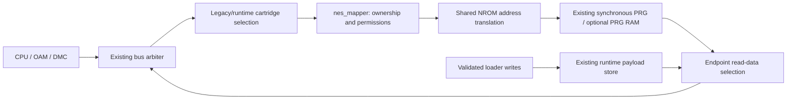
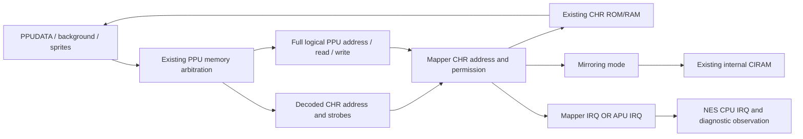

# Phase 7A — cartridge mapper framework

Phase 7A implements a shared cartridge address/permission boundary and retains
Mapper 0 as the **only supported mapper**. UxROM (2), CNROM (3), MMC1 (1) and
MMC3 (4) remain unsupported. There are no bank-register or IRQ-counter stubs.
The [entry assessment](phase7a-mapper-assessment.md) records the starting
architecture and passing baseline. [Welland hardware checks](phase7a-welland-validation.md)
remain pending.

## Implementation and reuse

`rtl/cartridge/nes_mapper.sv` owns support/configuration checks, CPU ownership,
physical PRG/CHR/RAM addresses, write permissions, mirroring and IRQ policy.
`nes_mapper0_address.sv` extracts the identical PRG translation previously
duplicated in both NROM endpoints. It has no memory or state.

`nes_mapper0.sv` retains its initialized PRG ROM, CHR ROM/RAM, optional 8 KiB
PRG RAM, debug conventions and registered reads. The former
`nes_runtime_mapper0.sv` is adapted as `nes_runtime_mapper.sv`; it retains
the same `storage` instance, loader write port, M10K inference and collision
forwarding. Neither memory was reimplemented. Runtime capacity remains exactly
32 KiB PRG plus 8 KiB CHR, with no PRG RAM.

The cartridge shells, loader, manifest validation, activation state machine,
command/status CDC and physical pins remain. Old standalone NROM benches tie
off the unused stateful-mapper timing observations; production wires the real
observations. No CPU, DMA, rendering, NMI, video or audio algorithm changes.





## Common interface

All signals use the existing 50 MHz fabric clock. Clock-enable events are data
inputs, never clocks. There is no new clock domain or CDC.

| Interface | Meaning |
|---|---|
| `clk`, `reset` | Fabric clock and mapper functional reset; future state belongs to this epoch |
| `configuration_valid` | Lifecycle owner has selected an active configuration |
| `mapper_number[7:0]` | Classic-iNES ID; only 0 is implemented |
| `prg_rom_bytes[23:0]`, `chr_rom_bytes[23:0]` | Physical payload counts; CHR-RAM declares zero ROM bytes |
| `chr_is_ram`, `prg_ram_enable` | CHR write policy and optional legacy 8 KiB PRG RAM; runtime RAM enable is tied low |
| `initial_mirroring[1:0]` | Existing vertical/horizontal/lower-single/upper-single encodings 0/1/2/3 |
| CPU address/read/write/write data | Arbiter-selected cartridge bus and accepted one-cycle transaction strobes |
| `cpu_cycle_tick` | Every scheduler CPU slot, including non-cartridge and DMA slots; freezes with debugger/reset |
| CHR address/read/write | Existing decoded 13-bit pattern-memory port; data remains connected directly to endpoint memory |
| `ppu_cycle_tick` | Enabled PPU dot event |
| `ppu_bus_address[13:0]`, read/write | Existing arbitrated logical PPU memory activity, including non-CHR accesses |
| `mapper_supported` | Implemented ID, independent of reset/image validity |
| `config_valid` | Selected supported image with exact NROM PRG/CHR sizes, independent of reset |
| `cpu_prg_select`, `cpu_ram_select` | Reset-gated address ownership, independent of strobes |
| `cpu_read_valid`, `chr_read_valid` | Permitted accepted reads; simultaneous read/write is rejected |
| PRG, PRG-RAM and CHR addresses `[23:0]` | Byte offsets; invalid configuration yields zero; NROM uses low 15/13 bits |
| PRG-RAM / CHR write enables | Reset/configuration-gated permissions and accepted writes |
| `mirroring_mode[1:0]` | Mapper-selected CIRAM policy; NROM passes initial mode; invalid selects vertical |
| `irq` | Active-high IRQ; always zero for the only implemented mapper |

The 24-bit internal offsets leave room for banked classic-iNES payloads without
allocating memory. They **do not widen MMIO or installed storage**. Runtime
zero-extends existing 16-bit metadata and retains narrow physical memory ports.
Configuration checks precede physical address truncation.

Read data remains an endpoint responsibility: ownership selects the existing
registered PRG/RAM byte; the CHR port returns its registered byte. Unsupported
or unselected runtime configurations return zero. ROM has no CPU-side write
port. NROM ROM writes remain observable and ignored; future register logic
can consume the same CPU address/data/write strobes.

Ownership must not wait for `cpu_read`: memory reads still run on **every fabric
edge**, establishing data before console bus acceptance. No extra latency or
ready/wait-state interface was introduced. A future backend must meet this
latency or explicitly redesign console scheduling; an arbitrary-latency SDRAM
port cannot simply replace these memories.

## NROM address mapping

| Bus range | NROM-128 | NROM-256 |
|---|---|---|
| CPU `$8000-$BFFF` | PRG `$0000-$3FFF` | PRG `$0000-$3FFF` |
| CPU `$C000-$FFFF` | PRG `$0000-$3FFF` again | PRG `$4000-$7FFF` |
| CPU `$6000-$7FFF` | Optional legacy PRG RAM `$0000-$1FFF` | Same |
| CPU below `$6000` | No cartridge memory ownership | Same |
| PPU `$0000-$1FFF` | CHR `$0000-$1FFF` | Same |

Build-time mirroring supports all four existing CIRAM modes. Runtime manifests
still accept horizontal/vertical only. Debug widths and meanings are retained:
legacy PRG-RAM debug strobes observe the region even when RAM is disabled;
runtime ROM-write debug data still exposes CPU write data. These debug strobes
are not memory permissions. No snapshot/MMIO format changes.

## Selection, reset and replacement

```text
physical reset -> legacy build-time cartridge selected
BEGIN          -> NES held; mapper access and IRQ disabled
WRITE          -> loader updates the single runtime store
COMMIT         -> complete image validated; NES remains held
ACTIVATE       -> active metadata changes atomically under mapper reset
four cycles    -> reset released; new mapping and natural CPU reset-vector boot
```

Storage and loader remain on physical reset; mapper reset also follows the
existing load/activation hold. Thus a load never resets its own write port.
Legacy mapper reset also follows the hold. No memory-clearing reset loop was
added. NROM has no bank registers; replacement reselects its combinational
mapping after the reset window.

One intentional internal change strengthens isolation: runtime read data is
zero during mapper hold or before valid selection, in addition to existing
strobe suppression. The NES is already reset then, so no console-visible cycle
changes. The lifecycle test explicitly checks this behavior; retained gameplay
and system tests remain regression gates.

CHR-RAM bytes remain retained across reset/replacement, as before. Software
must initialize them. Retained bytes are distinct from stale mapper bank state.

## Manifest, software and failed loads

Both external contracts remain unchanged: loader MMIO **1.0** at `0xff200000`
and diagnostics MMIO **1.3** at `0xff201000`. No register, bit allocation,
command, error priority, CDC protocol or generated definition changes.

The strict iNES parser and manifest serialization remain the entry path.
`SUPPORTED_MAPPERS = {0}` is shared by software metadata and manifest checks.
Library/CLI behavior still rejects future IDs. `execute_load_plan` additionally
validates manually constructed public plans before any transport operation:
invalid field types, non-byte payloads, mapper/size/mirroring or mismatched
payload lengths cause preflight
failure. Tests activate an image first and prove unsupported replacement plans
leave MMIO submission count, bytes and runtime status unchanged.

Raw FPGA commands preserve the established protocol: unsupported BEGIN reports
error 8, writes no payload, preserves active metadata and enters safe hold.
Aborting a **valid** transfer may leave overwritten bytes in the single store;
execution remains held until a complete reload/activation or physical reset
back to legacy. There is no transactional rollback or promise of continued
gameplay after arbitrary raw MMIO failure.

## Future integration and limits

| Phase | Reusable boundary | Remaining work |
|---|---|---|
| 7B UxROM | Register writes, wide PRG offsets, CHR-RAM permission | Bank registers/windows, variant/bus conflicts, larger storage/loading contract |
| 7C CNROM | Preserved CPU mapping and wide CHR offsets | CHR bank registers/storage, variant/bus-conflict policy |
| 7D MMC1 | CPU-slot events, write data, mirroring, RAM permissions, reset | Serial/consecutive-write behavior, banking, board/RAM policy |
| 7E MMC3 | Logical PPU activity, CPU/PPU events, IRQ route, mirroring/RAM control | Bank modes, RAM protection, A12 waveform/filter and IRQ revision qualification |

PPU observation travels from `ppu_background_core` through `ppu_sprite_core`
and `nes_core`, before CHR-only decoding. It is a **logical memory bus**, including
internal palette requests, not a validated physical PPU address-pin waveform.
MMC3 work must qualify idle address hold, dummy/background/sprite fetches,
PPUDATA/palette-refill behavior, M2 phase and IRQ revision. Counting CHR requests
or rendered scanlines is insufficient. Existing CPU/PPU enables preserve timing
and debugger/DMA context for that future work. See
[MMC1](https://www.nesdev.org/wiki/INES_Mapper_001) and
[MMC3](https://www.nesdev.org/wiki/MMC3) for the motivating hardware behavior.

No runtime PRG RAM, save persistence, four-screen RAM, NES 2.0/submappers,
bus-conflict emulation or larger allocation is claimed. For conflict variants,
the endpoint's synchronous ROM byte is available; future write-data resolution
must use the old bank before register state commits.

Unowned/disabled CPU cartridge reads retain the repository's deterministic-zero
behavior; this phase does not add a CPU open-bus latch. A future board variant
that depends on open bus must propagate the mapper's ownership/read-valid
information into the system-bus data resolver. Likewise, four-screen boards
would need additional nametable storage/routing beyond the existing two-bit
CIRAM policy. NROM-specific loader assertions remain appropriate while only
Mapper 0 is accepted and must evolve with each future support policy.

**Phase 7B prerequisite:** choose capacity/backend and a versioned loading
extension. Existing 16-bit sizes cannot describe a 64 KiB or larger PRG image,
and installed PRG capacity is 32 KiB. Phase 7A does not reinterpret existing
MMIO fields. The translation boundary is ready for bank logic; the current
loader/storage cannot claim ordinary UxROM image support.

## Verification matrix

| Requirement | Automated evidence |
|---|---|
| Power-on and selection | New framework bench: 256 IDs; invalid PRG/CHR sizes including nonzero high bits |
| NROM mapping/boundaries | All 65,536 CPU addresses across 32 configurations and every CHR offset; retained memory tests |
| Permissions/mirroring/concurrency | New exhaustive framework test; retained PRG-RAM, CHR-ROM/RAM and CIRAM tests |
| Reset/replacement/stale bank | 32 framework epochs; four runtime loads and eight resets in the new lifecycle bench |
| Unsupported FPGA loads | All 255 IDs through real BEGIN/WRITE; unchanged active metadata/bytes and asserted hold |
| Aborted loads | Retained validation tests and new partial-transfer/incomplete-COMMIT case |
| Inactive IRQ | Continuous/asserted checks in both new benches; production IRQ OR route |
| PPU observer | Existing independent Phase 3E Python vectors also check full exported address/read/write |
| Software support/serialization | 49 new Python cases; all IDs, eight NROM combinations, literal wire-format expectations |
| Preflight failure safety | Active-state/byte comparisons with zero new MMIO submissions |
| CLI and invalid files | Unsupported IDs rejected before opening a nonexistent device; truncation; retained CLI/library tests |
| CDC/gameplay | Retained MMIO/CDC, parser-to-boot, 300-frame gameplay, VGA, debugger and Phase 6G system gates |

Focused commands are `scripts/test_mapper_framework.sh` and
`.venv/bin/python -m pytest tests/python/test_mapper_framework.py -q`.
The RTL checks run in FAST and FULL through `scripts/sim.sh`, with assertions,
fatal failures, bounded timeouts and `set -euo pipefail`. No retained test or
gate was removed. Unit results: 2,097,547 framework checks; four runtime loads
and 266 directed checks; 49 passing Python tests.

The complete local `scripts/test.sh` gate passed on 2026-10-14 with **2,300
Python tests** (baseline 2,251; 49 added), warning-free full Verilator lint,
all retained RTL/gameplay/debugger checks and the final Phase 6G system run.
The complete FAST RTL profile also passed. No retained PASS result changed;
the two new mapper benches add two PASS records (103 baseline, 105 final).

| Final simulation | Observed result |
|---|---|
| PPU observer and existing Phase 3E reference | 1,075,191 rows, 1,018,972 PPU ticks, 11 frames, zero mismatches |
| CPU/runtime activation | Three reset-vector boots, one replacement, three vector/CHR checks |
| Retained gameplay | 26,713,128 cycles, 300 frames, 297 NMI/DMA/controller polls |
| VGA / Developer Mode | 69,720,005 cycles, 84 frames, 82 snapshots; 307,200 compared pixels, zero mismatches |
| Debugger gameplay | 132 frames, 187 commands/acknowledgements, 71 instruction steps, 41 frame steps |
| Phase 6G production system | 35,588,469 cycles, 52 PPU frames, 13 reset epochs, 155,949 MMIO commands, zero mismatches |
| Phase 6G peripheral observations | DMA 9; DMC 2,674; controller reads 32,650 / 32,648; PCM 31,012 (30,971 nonzero); WM8731 words 30,969; HDMI words 13,260 |
| Phase 6G video comparison | VGA 307,200 pixels; HDMI 921,600 pixels; zero mismatches |

The Phase 6G observations exactly reproduce the fresh baseline, including
peripheral counts. This demonstrates observable execution and A/V behavior,
not just successful cartridge loading. The final system simulation took
408.233 seconds. Local command logs, measurements and report archives are
under ignored `build/phase7a/`; baseline evidence is under its `baseline/`
subdirectory. CI retains FAST feature pushes and FULL PR gates without adding
a separate workflow or weakening any quality gate.

A local mutation check inverted the NROM-256 upper-bank address bit in a
temporary copy outside production RTL. The framework bench failed its PRG
scoreboard and returned exit 134. This verifies that a wrong bank is detected
and produces a nonzero process result; the mutation is not committed.

## Timing and physical qualification

Production and logical HDMI SDC files are unchanged. The standalone runtime
QSF/SDC adds only new logical observation/status ports to its existing virtual
untimed I/O boundary; no existing path is newly exempted. Production implicit-net
rejection remains enabled. Baseline resources/timing/warnings are in the entry
assessment. The final production build passed synthesis, fitting, assembly,
RBF generation and fully constrained all-corners STA with unchanged constraints.

| Production measurement | Baseline | Phase 7A |
|---|---:|---:|
| ALMs | 9,574 | 9,667 |
| Logic ALUTs | 12,974 | 13,027 |
| Routing ALUTs | 3,795 | 3,721 |
| Memory ALUTs | 590 | 590 |
| Registers / dedicated logic registers | 15,046 / 14,820 | 15,090 / 14,864 |
| M10Ks | 275 | 275 |
| DSPs / PLLs | 7 / 2 | 7 / 2 |
| Minimum setup slack | +1.048 ns | +0.913 ns |
| Minimum hold slack | +0.077 ns | +0.077 ns |
| Minimum recovery / removal slack | +3.375 / +0.460 ns | +3.375 / +0.460 ns |
| Minimum pulse-width slack | +0.608 ns | +0.608 ns |
| TNS, every reported corner | 0.000 ns | 0.000 ns |
| Map / fit / assembly / STA warnings | 105 / 149 / 0 / 144 | 106 / 149 / 0 / 144 |

The 93-ALM increase (0.97%) and 44 additional registers accompany validation
of the complete active runtime configuration and reset-gated mapper policy;
PRG/CHR memory allocation and registered RAM inference remain unchanged.
The fitter's cartridge hierarchy increases from 181.1 to 204.5 estimated ALMs
and 168 to 191 dedicated registers; its new runtime mapping child accounts for
19.6 estimated ALMs and zero registers. Whole-design totals also reflect
changed packing, duplication and routing, so the full 93-ALM increase is not
attributed solely to mapper logic.
The limiting setup path is still `video|output_active` to a VGA color output
(now `VGA_G[0]`, previously `VGA_B[2]`), not a mapper path. The limiting hold
path remains the HPS DDR `lfifo` to `os_oct_ddio_oe` path. Setup margin decreased
by 0.135 ns, with no negative slack and no constraint changes.

Warning review found three additional Quartus 10036 warnings for intentionally
unused interface-reduction signals (`unused_mapping` in both endpoints and
`unused_stateful_inputs` in the mapper), three fewer 10030 undriven inferred
memory-port warnings, and one additional 12158 dangling-pin warning in generated
HPS `altera_mem_if_hhp_qseq_synth_top` IP. Fitter and STA warning categories/counts
are unchanged. No new project-owned implicit net, inferred latch, multiple
driver or unexplained clock/reset warning was accepted; no warning suppression
was added. The existing generated HPS DDR `pll_dr_clk` implicit-net warning
remains outside project-owned RTL. Complete reports and critical paths are
archived locally under ignored `build/phase7a/production-reports/`.

The logical HDMI target also passed synthesis, fitting, assembly and fully
constrained all-corners STA. Every measured resource and minimum slack matches
the fresh baseline: 3,297 ALMs, 4,819 logic ALUTs, 513 routing ALUTs, zero memory
ALUTs, 4,430 registers, 210 M10Ks, eight DSPs and two PLLs. Minimum setup/hold
slack is +0.747/+0.123 ns; recovery/removal is +9.784/+0.740 ns; minimum pulse
width is +0.612 ns. All TNS values are zero. Map/fit/assembly/STA warnings remain
22/3/0/0, with no errors. Reports are in `build/phase7a/hdmi-reports/`.
This separate target does not contain the NES mapper, so unchanged results
are expected; its retained compatibility gate still ran.

The additional standalone runtime-cartridge build passed synthesis, fitting,
assembly and fully constrained internal timing: 405 ALMs, 388 logic ALUTs,
three routing ALUTs, zero memory ALUTs, 162 registers, 40 M10Ks, zero DSPs and
zero PLLs. Minimum setup/hold/pulse-width slack is +12.762/+0.171/+8.428 ns;
all TNS values are zero. Its virtual I/O boundary is deliberately untimed and
is not a board timing claim. Map/fit/assembly/STA warnings are 4/1/0/0: two
unused interface reductions, the NROM IRQ tied to ground (summary plus pin
warning), and the Quartus Lite LogicLock license notice. No latch or multiple
driver was inferred. Reports are in `build/phase7a/runtime-reports/`; no fresh
standalone baseline was measured, so no before/after claim is made for it.

Production remains VGA/WM8731/HPS; HDMI remains a separate logical target.
No physical DE1-SoC, HDMI, USB-C or signal-integrity test is claimed. The Welland
checklist preserves all Phase 6 hardware obligations.
