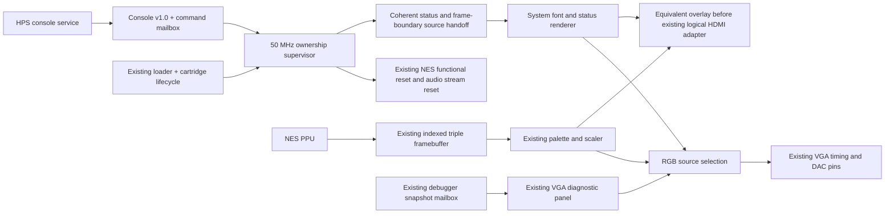
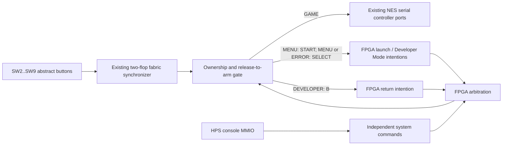

# Phase 8A — Independent console ownership

## Entry audit and architecture decision

The clean entry point on `phase8/console-ux-architecture` is
`bbde4c4af8094e05d0817bfc8cbc0368ef48e8dd`. A fresh origin fetch confirmed
that HEAD, origin/main and the branch upstream all identify that commit.
It contains merged Phase 6G PR #52 and Phase 7A PR #53. The available process
and worktree inventory showed no competing worker in this worktree; the
separate, retained Phase 3J worktree was not changed. No AGENTS.md was found
in the workspace or its parent directories. README.md and the phase reports
are the repository's canonical roadmap; there is no separate tracked roadmap.

The physical board is unavailable. Every physical test remains **pending**.
Fresh baseline logs are under ignored `build/phase8a/baseline/`.

During final verification, origin/main advanced to `8f8a692` through PR #54.
That merge adds only the Phase 7B capacity assessment and README text; it
contains no mapper implementation or RTL changes. The fresh Phase 7A baseline
measurements therefore remain the code baseline for this work. Phase 8A does
not implement the unfinished Phase 7B backend or mapper work.

| Existing responsibility | Implementation and preserved contract |
|---|---|
| Production | `de1_soc_nes_vga_top`, Cyclone V 5CSEMA5F31C6 |
| NES execution | 50 MHz fabric, rational NTSC enables, coherent debugger gating; CPU/PPU/APU and DMA timing stay in this domain |
| VGA | 25.2 MHz independent raster, indexed triple-bank `nes_framebuffer`, palette/scaler and registered DAC output |
| Logical HDMI | Separate Phase 6D virtual-pin target, approximately 74.25 MHz 720p raster and independent audio transport; no production HDMI pins or second production framebuffer |
| Developer Mode | Independent font/panel renderer with frame-stable coherent snapshots and command mailbox; rendering does not execute NES code |
| Cartridge | Existing HPS loader, single runtime PRG/CHR store, complete-image COMMIT and explicit ACTIVATE; Mapper-0-only Phase 7A translation boundary |
| Software | Python iNES validation, library discovery, streaming load plans, bounded MMIO transport; no existing graphical Linux scanout service |
| MMIO | Loader v1.0 at 0xff200000 / 64 bytes; diagnostics v1.3 at 0xff201000 / 512 bytes |
| Input | Synchronized SW2..SW9 abstract Player-1 vector and authentic $4016/$4017 serial ports; Player 2 has no physical provider |
| Audio | Existing APU PCM/resampler, coordinated async FIFO reset and WM8731 initialization; functional reset silences and reprimes the stream |
| Reset | Physical/PLL reset stops the system; functional cartridge/HPS resets invalidate both framebuffer endpoints, debugger epochs and audio content while VGA timing continues |
| Verification | `scripts/test.sh`: complete Python, lint, RTL, debugger and Phase 6G production integration; FAST preserves Python/full lint/focused RTL |
| Quartus | Production VGA/HPS/WM8731 and separate Phase 6D HDMI A/V qualification builds; existing all-corners nonnegative-slack and constrained-path gates |

### Decision before RTL implementation

Use a small fabric-domain ownership supervisor, an independent status renderer
that reuses `debug_font_pkg` and existing raster coordinates, and a coherent
frame-boundary display handoff. Keep the existing framebuffer exclusively
owned by its NES capture/scanout protocol. The UI requires no framebuffer.
Keep the mature diagnostic panel and debugger features.

Use a separately versioned console MMIO aperture for HPS intentions and
acknowledgements. Preserve both existing register maps. Software remains
responsible for file/library policy and byte transfer; FPGA logic owns reset,
input admission and display admission. Do not build an HPS framebuffer path:
there is no qualified transport/scanout for one, and it would add memory,
bandwidth and failure dependencies without helping this foundation.

Recoverable faults include stopped/stalled NES execution, absent gameplay
frames, invalid or interrupted loads, unsupported raw mapper requests,
cartridge replacement and HPS bridge interruption. Recovery may require a
complete reload. Runtime writes cannot be rolled back. This does not promise
UI operation through FPGA reset, clock/PLL loss or failed output hardware.
NES progress alone cannot prove a game is healthy; no instruction-loop
watchdog is proposed.

The fresh baseline completed before production RTL changes: **2,300 Python
tests** (130.77 s), full lint with no warnings/errors, **105 RTL PASS records**,
and both required Quartus flows. The production-system run reproduced
35,588,469 cycles, 52 PPU frames, 13 reset epochs and 155,949 loader commands,
with zero mismatches. Both merged PRs' verification checks were also confirmed
successful through GitHub. Baseline reports and critical paths are archived
in `build/phase8a/baseline/{production,hdmi}-reports/`.

## Implemented modules and ownership

* `nes_console_control`: fabric-domain intention arbitration, state, epoch,
  input admission, frame-acknowledged launch and bounded launch failure.
* `nes_console_mmio`: separate console v1.0 Avalon register bank.
* `nes_console_mailbox`: parameterized held request/response banks with
  three-stage toggle handshakes, following the established debugger protocol.
* `nes_console_video`: coherent frame-stable status and source selection;
  coordinates unilateral system/display resets at both mailbox endpoints.
* `nes_console_renderer`: registered direct-pixel text/status screen using
  `debug_font_pkg`; no PPU input, frame memory, CPU, Linux framebuffer or DMA.
* `nes_console_720p_overlay`: the same screen in a centered 640x480 canvas on
  the logical 1280x720 output, with the existing pixel pipeline latency.



The diagram shows equivalent output integrations, not simultaneous physical
VGA/HDMI on the DE1-SoC. Production retains its one triple framebuffer. The
production-top integration bench's second framebuffer is a simulation sink.
The standalone Phase 6D target retains its synthetic source and exercises the
same overlay: SOURCE_RESET holds that source and displays SYSTEM; release
waits for a complete synthetic frame before admitting GAME. It is not a
second console supervisor or a physical HDMI image. The logical overlay shows
console diagnostics in Developer Mode; the rich existing snapshot panel
remains on production VGA.

## State and transition contract

HPS owns file selection, preflight validation and transfer policy. FPGA logic
owns every state below and all reset/input/display admission. The shared
status distinguishes an accepted intention from its visible completion.
State numbers are part of `config/console_mmio.json`.

| State | NES execution | Desired display | Input owner | Audio |
|---|---|---|---|---|
| 0 INITIALIZING | Reset | SYSTEM | System, disarmed until stable | Muted/reset |
| 1 MENU | Reset | SYSTEM | System navigation | Muted/reset |
| 2 LOADING | Reset | SYSTEM | No navigation action | Muted/reset |
| 3 STARTING | Released if cartridge/bridge permits | GAME only with valid framebuffer; otherwise SYSTEM | No game input yet | Muted/reset |
| 4 GAME | Existing enables/debugger policy | GAME | Game, after release-to-arm | Existing audio pipeline runs |
| 5 RETURNING | Reset | SYSTEM | No navigation action | Muted/reset |
| 6 ERROR | Reset | SYSTEM | System navigation | Muted/reset |
| 7 DEVELOPER | Existing cartridge/reset/debugger policy | SYSTEM status + existing VGA panel | Developer navigation; game vector zero | Muted/reset |

Developer Mode can run/pause/step the NES using the existing debugger commands.
It does not itself force NES reset when a valid cartridge is available. An
invalid loader session still holds the NES. No frame from the game is shown
in this mode, so a paused/stalled/invalid game cannot obstruct diagnostics.

| Transition/request | Preconditions and owner | Acknowledgement/completion | Fault/timeout and cartridge behavior |
|---|---|---|---|
| Physical initialization → MENU | FPGA clock/reset/PLL release | Current-epoch SYSTEM display ack | No gameplay required; immutable built-in cartridge remains selected, runtime inactive |
| MENU/ERROR/DEVELOPER → LOADING | HPS PREPARE_LOAD, fresh epoch | Command result OK; state LOADING | HPS performs existing bounded transfer; interruption leaves safe hold, no rollback |
| Any state → LOADING/ERROR on BEGIN | Existing loader accepted BEGIN | FPGA advances epoch and observes loader result | Invalid BEGIN is still a safe-stop transaction; error code preserved |
| LOADING → RETURNING → MENU | Existing ACTIVATE accepted | Existing metadata/reset window, then current-epoch SYSTEM ack | Loading never implicitly grants gameplay input/display |
| MENU/DEVELOPER → STARTING → GAME | HPS LAUNCH, or fresh local START in MENU; cartridge available, bridge not reset | Current-epoch GAME display ack from valid complete framebuffer | 100,000,000 fabric clocks (2 s at 50 MHz) without admission → ERROR 15 and reset |
| Any state → RETURNING → MENU | Fresh HPS MENU; local B in DEVELOPER | Current-epoch SYSTEM display ack | Cartridge selection retained; NES restarts on a later launch, not a save/resume feature |
| Any state → DEVELOPER | Fresh HPS DEVELOPER; local SELECT in MENU/ERROR | Command accepted, then software waits for source DEVELOPER ack | Render/status remains operational while NES reset or stalled; existing snapshot may be invalid/stale |
| Any state → ERROR | New loader error or HPS REPORT_ERROR | Safe stop immediately; SYSTEM at next source commit | Loader error 1–14 retained; host error 14 or launch admission timeout 15 identified by context |
| ERROR → retry | MENU then valid existing load, or PREPARE_LOAD directly | Complete BEGIN/write/COMMIT/ACTIVATE, then explicit LAUNCH | Partially overwritten runtime bytes cannot be restored by returning to MENU |
| HPS bridge reset edge → INITIALIZING | FPGA observes established bridge reset | Epoch changes; pending HPS mailbox commands cleared at both endpoints | Persistent HPS reset permits SYSTEM/DEVELOPER navigation after UI ack, but game availability stays false |

The display source column describes the requested stable state. During a
transition, status separately reports the last acknowledged source. Gameplay
is blanked at a pixel edge while SYSTEM admission is pending; it is never
substituted underneath recovery diagnostics. A missing valid game frame keeps
SYSTEM selected. Framebuffer ownership/publication logic is unchanged.

Arbitration order is physical system reset, bridge-reset edge, newly observed
loader error, BEGIN, ACTIVATE, HPS intention, local navigation, then autonomous
completion. A loader/reset event concurrent with a mutating HPS command
returns STALE. SELECT wins over START when both local edges occur together.
STATUS is observation-only. Invalid/stale/unavailable requests do not acquire
ownership. An HPS client must not retry a stale mutating request automatically.

## Boot, launch, return and recovery sequences

```mermaid
sequenceDiagram
  participant H as HPS software
  participant C as Console supervisor
  participant L as Existing cartridge loader
  participant V as Existing scanout + console ownership
  participant N as NES subsystem
  C->>N: Hold functional reset, mute stream, suppress game buttons
  C->>V: SYSTEM status, initialization epoch
  V-->>C: SYSTEM committed at raster boundary
  C-->>H: MENU
  H->>H: Validate existing file/library selection
  H->>C: PREPARE_LOAD with observed epoch
  H->>L: BEGIN / sequential writes / COMMIT / ACTIVATE
  L-->>C: New load epoch, then activation accepted
  C->>V: SYSTEM, new activation epoch
  V-->>C: SYSTEM committed
  H->>C: LAUNCH with fresh epoch
  C->>N: Release console reset hold; input/audio still withheld
  N->>V: Existing complete-frame publication
  V-->>C: GAME committed, matching epoch
  C->>N: Admit released-then-pressed game input; release audio stream reset
  H->>C: MENU / REPORT_ERROR
  C->>N: Assert established functional reset; silence and flush audio
  C->>V: Inhibit game, request SYSTEM with new epoch
  V-->>C: SYSTEM committed
```

Startup with no runtime game is intentional. The built-in project-owned NROM
remains available as a launchable diagnostic game; it does not execute to
produce the menu. The UI's GAME READY means a cartridge is available to launch,
not that an initial gameplay frame has already been published.

## Input routing



Every state/epoch handoff disarms input until all synchronized buttons are
released. Menu actions are edge-triggered. A held START used to launch cannot
become a game START press, and held gameplay buttons cannot trigger menu
actions after return. Once armed in GAME, the routing is combinational after
the existing synchronizer: it adds no sampling stage or NES-controller polling
latency. Authentic serial latching and $4016/$4017 behavior are unchanged.
This is release-to-arm behavior for the synchronized digital button vector;
no new mechanical-switch debounce filter is claimed. Contact bounce and the
future controller provider's disconnect/release policy need physical testing.
SW0 test pattern and SW1 capture freeze retain their gameplay functions. No game-button
chord is reserved. Return from GAME is an HPS system command; KEY0 remains a
whole-system reset. A physical system/home-button transport is a later Phase 8
dependency. The current Player-2 physical provider remains absent.

## MMIO and software compatibility

Loader **v1.0**, its 64-byte aperture and all failed-BEGIN/no-rollback semantics
are unchanged. Diagnostic **v1.3**, its 512-byte aperture, trace and counters
are unchanged. Phase 7A Mapper-0 translation, manifest validation and capacity
are unchanged. The regenerated Platform Designer system adds a third bridge
at **0xff202000**, 32 bytes, console **v1.0**, magic **0x4e455343**.

| Offset | Register | Meaning |
|---|---|---|
| 0x00 / 0x04 / 0x08 | MAGIC / VERSION / CAPABILITIES | Identity, 0x00010000, capability mask 7 (epochs, frame ack, local input) |
| 0x0c | BRIDGE | bit 0 ready, bit 1 pending, bit 2 rejected submission |
| 0x10 | COMMAND | Full-word write only: epoch[31:16], reserved zero[15:4], opcode[3:0] |
| 0x14 | RESPONSE | Coherent pre-command observation; STATUS polls observe subsequent completion |
| 0x18 | RESULT | 0 OK, 1 STALE, 2 INVALID, 3 UNAVAILABLE |
| 0x1c | COMPLETED | 32-bit modulo transaction counter, reset with bridge |

Commands are STATUS=0, MENU=1, LAUNCH=2, DEVELOPER=3, PREPARE_LOAD=4,
REPORT_ERROR=5. STATUS ignores the submitted epoch. A mutation must match the
current 16-bit modulo ownership epoch. BEGIN, ACTIVATE, accepted intentions,
bridge reset and timeout advance it. This is bounded command freshness, not
an authentication nonce or persistence across physical reset. Both mailbox
endpoints are cleared on bridge/physical reset so an in-flight old transaction
cannot execute after restart. Partial/busy submissions set rejected without
overwriting the held bank; the next accepted submission clears rejected.

RESPONSE contains state[3:0], input owner[5:4], acknowledged video source[7:6],
game available[8], runtime active[9], loader state[11:10], error[15:12], and
epoch[31:16]. SYSTEM/GAME/DEVELOPER source/owner encodings are 0/1/2. The
separate coherent display packet adds the button vector and NES reset state.

`software.nes_console` uses the existing `DevMemMmio`, `GameLibrary`, iNES
parser, load plan and transport. Its default 3 s console wait is bounded;
load command/validation/activation timeouts remain those of the existing
loader. It distinguishes acceptance from frame completion, checks exact
completion-counter progression, and rejects an ownership wait superseded by
a different epoch. The CLI uses an exclusive Linux flock. All software/raw
MMIO producers, including the older loader CLI, must be serialized by system
policy; the lock cannot constrain a separate raw-MMIO process that ignores it.

```sh
python3 -m software.nes_console status
python3 -m software.nes_console load /media/games/owned.nes
python3 -m software.nes_console load GAME_ID --library /media/games
python3 -m software.nes_console menu
python3 -m software.nes_console launch
python3 -m software.nes_console developer
```

The `LEGACY_AUTORUN=1` compatibility parameter preserves the exact earlier
gameplay/debugger regression profile. It is explicitly selected by three
retained benches, never by the production QSF. Console MMIO identity and
capabilities are zero in that profile, so software cannot mistake bypassed
ownership for a working console interface. The new integrated bench tests
the production default with actual HPS transactions and cartridge streams.

## Reset, CDC and Developer Mode independence

| Crossing | Source → destination | Delivery and reset contract |
|---|---|---|
| Physical buttons | Asynchronous pins → 50 MHz | Existing two-flop button synchronizer; reset and all-release arming suppress held transitions |
| Console HPS commands | HPS user clock → 50 MHz | One held 32-bit request and 34-bit response; three-stage request/ack toggles; common existing bridge-reset assertion with local release |
| Console display packet | 50 MHz → VGA 25.2 MHz / logical 720p clock | Held 41-bit status/buttons/reset packet and 32-bit response; three-stage toggles; commit/ack at raw raster end |
| Video safety inhibit | 50 MHz → pixel clock | Two-flop level synchronizer; pixel-edge blanking; no multi-bit asynchronous mode select |
| Video mailbox reset | Either system/display endpoint → both domains | `reset_sync` common assertion and local release at both endpoints; NES content reset excluded |
| Content invalidation | Existing functional reset → pixel domain | Existing Phase 6G reset synchronizer and framebuffer invalidation; console samples blanking at pixel edge |
| Logical qualification hold | SOURCE_RESET → 50 MHz | Two-flop level sampling in qualification harness; content resets preserve raster and HDMI enable |

No new clock, PLL, framebuffer writer, CPU/PPU enable, cartridge-visible timing
path, or reset bypass is introduced. New HPS held-bank paths retain explicit
20 ns max-delay bounds; only first-stage toggle synchronizers receive the new
false-path exceptions. Display CDC follows the existing asynchronous
fabric/pixel clock groups and held-bank handshake. All prior constraints
remain. Digital simulations exercise protocol/reset phasing; they do not
simulate analog metastability.

The console supervisor and renderer reset with system/display reset, not NES
functional reset. Menu stop joins the existing functional-reset expression;
both framebuffer endpoints, debugger content/command epochs and audio recovery
therefore retain Phase 6G sequencing. Audio additionally uses the existing
source-reset input to mute Developer Mode while its NES execution may remain
live. Release uses the existing consumer-reset barrier, FIFO prefill and codec
initialization. No independent serializer reset path is added.

The existing debugger panel always renders in the pixel domain. Paused CPU/PPU
execution does not stop it; existing manual/paused-heartbeat captures remain.
During NES reset its snapshot is invalid, and it renders the existing invalid
status. Console state, loader status, reset, source, ownership, error and button
activity come from the independent console packet and remain useful. If HPS
is held in reset, FPGA local menu/Developer navigation and these fields remain
available, but loading and HPS commands do not. If HPS merely stops executing
without a bridge reset, the current mode remains; recovery from GAME requires
the existing physical reset or restored HPS command service. No physical home
button, USB HID, Bluetooth, remapping or pairing is claimed.

## Performance and scope limits

Steady-state NES scheduling, memory access, PPU pixel capture, controller
serialization and APU computation are unchanged. The UI has no storage or
bandwidth contention with NES memory. Its renderer adds no pixel pipeline
latency: it uses the same one-stage-early render coordinates as the existing
debugger. New 720p coordinate outputs are observation-only.

The continuously offered one-entry display mailbox can contain a preceding
status observation. A new source intention therefore commits within at most
two output frame boundaries plus handshake clocks under normal clocking.
Game startup also waits for the existing complete-frame framebuffer handoff.
The 2 s watchdog bounds STARTING; LOADING remains safely stopped indefinitely
if HPS disappears, allowing later MENU/reload recovery. Frame-boundary waits
are control latency, not additional game-controller polling latency.

Returning to MENU restarts the game on next launch. Save/resume, animated
transitions, a graphical file selector, controller pairing/profiles and a
Linux framebuffer transport are not implemented. All NROM/CHR capacity and
future mapper/SDRAM constraints from Phase 7A remain. No Phase 7B storage work,
Mapper 2, MMC1 or MMC3 support is introduced.

## Verification coverage and physical bring-up

| Evidence | Coverage |
|---|---|
| Python console contracts | State preconditions, request/epoch encoding, MMIO identity, stale/unavailable/invalid handling, bounded waits, reset counter detection, superseded launch, existing library load and interrupted transfer without rollback |
| Supervisor RTL | All 48 state/command pairs reached through public events, absent runtime cartridge, frame timeout, held inputs, repeated modes, simultaneous HPS/local/loader priority, stale display ack, reset during launch, persistent HPS reset |
| Actual MMIO/CDC RTL | Unrelated HPS/fabric clocks, full-word requirement, busy rejection, exactly-once count, stale epoch after BEGIN, interrupted request and reset recovery |
| Video ownership RTL | Unrelated fabric/pixel clocks, frame-boundary selection, no valid frame, NES content reset, 32 switch/recovery phases, common and unilateral endpoint resets |
| Renderer RTL | 2,457,600 independent Python-reference pixels across eight states, blanking, no NES input |
| Default production top | Real VGA output and logical HDMI sink, NES held reset UI, physical START and input handoff, existing software-generated NROM128/256/CHR-RAM loads, paused CPU/PPU, Developer Mode, unsupported mapper, replacement, repeated menu/launch/reset, interrupted HPS requests and audio mute/recovery |
| Retained complete gate | All earlier Python, CPU/PPU/APU/DMA/controller/mapper/loader/debugger/video/audio/reset tests; no assertions removed or timing gate weakened |

`scripts/test_console.sh --unit` runs the small deterministic benches in FAST.
FULL additionally runs `nes_console_system_tb` and independent VGA/HDMI pixel
comparison. The system bench substitutes external HPS initiator and codec
responses, not the console policy, loader, memories or NES execution. Software
mock tests are contract evidence only. Physical operation is not inferred
from any simulation or Quartus result.

All of the following physical checks are **pending**:

1. Record board revision, bitstream/RBF hash, HPS handoff, monitor and power
   setup. Boot default production image with no runtime cartridge; verify
   stable VGA UI, reset indication and silent LINE OUT.
2. Exercise SW5 START from MENU, release it, then verify all eight controller
   switches and serial behavior in the built-in game. Confirm no held menu
   press reaches the game. SW4 SELECT enters Developer Mode from MENU;
   SW3 B returns from Developer Mode. Return from GAME through HPS `menu`.
3. Load owned NROM128/256 CHR-ROM/RAM images with the new CLI; verify frame
   admission, gameplay, unchanged controls and audio. Reject malformed and
   unsupported images and test a partial-transfer interruption followed by a
   full reload. Do not expect rollback of runtime bytes.
4. Pause/step/run with existing debugger controls, enter/exit Developer Mode,
   check stale/invalid snapshot labels, and verify the independent status UI
   when NES is held reset. Hold HPS bridge reset and check FPGA menu navigation.
5. Repeat menu/game/developer transitions, cartridge replacement and KEY0
   resets. Check for stale frames, unintended button actions, audible bursts,
   FIFO errors, clock failures and long-run instability.
6. On a separately qualified HDMI carrier, repeat UI/game switching, raster
   stability, HPD reconnection and audio tests. Stock DE1-SoC HDMI remains
   unavailable; the logical target and virtual pins are not hardware PASS.

Phase 8B can build graphical layout and navigation on these ownership and
renderer boundaries. It must separately design physical system controls,
library-selection UI policy and any richer asset transport. Future Phase 7
storage/mapper work must preserve the loader observation/reset interface or
version it explicitly; this phase adds no cartridge memory capacity.
The present Mapper 0 has no bank/IRQ state. Console MENU resets NES execution
without resetting the loader or discarding active metadata. A future stateful
mapper must receive that functional reset separately from loader/storage reset;
using the loader's reset for MENU would incorrectly discard the cartridge.
Phase 7A's existing replacement/activation mapper reset remains unchanged.

## Local qualification results — 2026-10-14

Baseline and final runs use Quartus Prime Lite 23.1std.1 build 993, the existing production
projects and unchanged timing acceptance criteria. Resource values are fitted
whole-design measurements, so placement and optimization affect the delta.

| Production VGA/HPS | Fresh baseline | Phase 8A |
|---|---:|---:|
| ALMs | 9,667 | 10,423 (+756, 7.82%) |
| Registers | 15,090 | 16,097 (+1,007) |
| M10Ks | 275 | 275 |
| MLAB bits | 18,880 | 18,880 |
| Block memory bits | 2,238,504 | 2,238,504 |
| DSP blocks / PLLs | 7 / 2 | 7 / 2 |
| Worst setup slack (ns) | +0.913 | +0.955 |
| Worst hold slack (ns) | +0.077 | +0.077 |
| Recovery / removal slack (ns) | +3.375 / +0.460 | +3.375 / +0.460 |
| Minimum pulse-width slack (ns) | +0.608 | +0.608 |
| Total negative slack (ns) | 0 | 0 |

Production synthesis, fitting, assembly, all-corner timing, SOF and RBF
generation succeeded. Setup and hold are fully constrained. The baseline
critical setup path was `video|output_active` to `VGA_G[0]`; the final path is
`console_video|selected_source[0]~DUPLICATE` to `VGA_R[6]`, with +0.955 ns
slack. This is the expected RGB ownership mux at the existing output boundary.
The hard HPS DDR interface still determines the minimum hold margin. No clock
or timing requirement was relaxed, and no new PLL, DSP or frame storage was
required.

Quartus warnings are retained and reviewed, not suppressed. Production stage
counts are synthesis 105 → 108, fitter 149 → 149, assembler 0 → 0, timing
144 → 144. The added synthesis warnings are the intentionally unused video
mailbox-ready/subpixel observations and a generated Qsys traffic-limiter width
truncation after adding the third bridge. Existing vendor HPS DDR warnings,
including `pll_dr_clk`, remain. There are no critical warnings, project RTL
implicit nets, inferred latches or multiple-driver warnings.

| Logical HDMI + audio | Fresh baseline | Phase 8A |
|---|---:|---:|
| ALMs | 3,297 | 3,705 (+408, 12.37%) |
| Registers | 4,430 | 4,564 (+134) |
| M10Ks | 210 | 210 |
| MLAB bits | 0 | 0 |
| Block memory bits | 1,698,344 | 1,698,344 |
| DSP blocks / PLLs | 8 / 2 | 8 / 2 |
| Worst setup slack (ns) | +0.747 | +0.564 |
| Worst hold slack (ns) | +0.123 | +0.121 |
| Recovery / removal slack (ns) | +9.784 / +0.740 | +10.166 / +0.685 |
| Minimum pulse-width slack (ns) | +0.612 | +0.612 |
| Total negative slack (ns) | 0 | 0 |

Logical HDMI synthesis, fitting, assembly and all-corner timing succeeded;
setup and hold remain fully constrained. The baseline worst setup path ran
from the pixel-reset synchronizer to `HDMI_RGB[7]`; the final worst path runs
from the registered console renderer `rgb[10]` to `HDMI_RGB[19]` through the
existing output adapter. Its +0.564 ns margin is smaller by 0.183 ns and still
passes the unchanged gate. Synthesis warnings are 22 → 24 (the same two
unused observations), fitter 3 → 3, assembler 0 → 0, timing 0 → 0. No critical
warning or unconstrained clock was introduced. Both timing reports include
the UI output path; no timing exception hides the added RGB mux.

Final reports, critical-path details and machine-readable resource/slack
measurements are archived locally under ignored `build/phase8a/final/`;
`quartus-production-final.log` and `quartus-hdmi-final.log` retain full tool
output. These are reproducible build artifacts, not physical test evidence.

| Local verification | Fresh baseline | Phase 8A |
|---|---:|---:|
| Python tests | 2,300 passed | 2,385 passed (+85), 113.61 s |
| Full Verilator lint | 0 warnings/errors | 0 warnings/errors |
| Retained RTL/integration PASS records | 105 | 105 |
| Added console PASS records | — | 7 |
| Combined RTL/integration PASS records | 105 | 112 |
| Independent eight-state renderer pixels | — | 2,457,600 matched |
| Default production menu capture | — | 307,200 VGA + 921,600 HDMI pixels matched |

The full local workflow's retained stages all passed, including the unchanged
Phase 6G system totals of 35,588,469 cycles, 52 PPU frames, 13 reset epochs and
155,949 MMIO commands with zero mismatches. Its new final stage initially
stopped on strict lint in the testbench's physical-reset monitor. The monitor
was corrected to use asynchronous reset sensitivity, without suppressing the
warning or changing production RTL. The complete console stage was then
rerun successfully with its four unit benches, default-production integration
and both independent pixel comparisons. Logs are `full-regression.log`,
`lint-final.log` and `console-final.log` under `build/phase8a/`; counts above
count the four unit benches once, not their repeated executions.

The final default-production console run completed **52,926,754 fabric
cycles**, **10 functional reset epochs** and **81,950 loader commands**. It
verified actual ROM controller reads, NROM128/256 and CHR-RAM replacement,
paused CPU/PPU diagnostics, unsupported mapper recovery, interrupted loading
and launch, repeated menu/game/developer transitions, two physical-reset
simulations, stable VGA/HDMI timing, and zero audio FIFO underruns/overruns.
The final captured UI is also rendered locally as `console-menu.png` for
visual review. This remains simulation evidence only.
