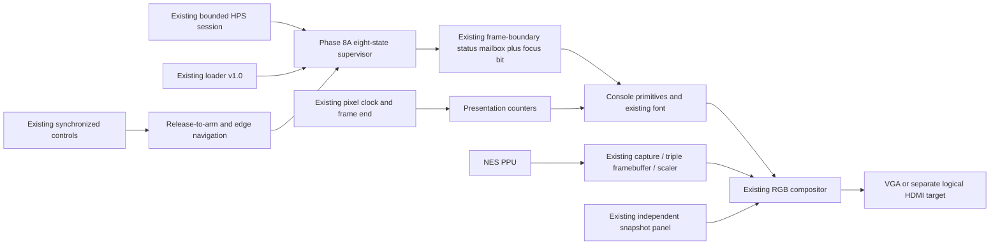
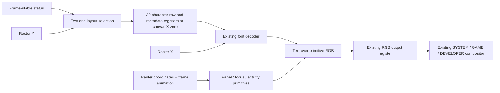

# Phase 8B — Boot experience and visual identity

Physical DE1-SoC validation is **pending**. This report distinguishes simulated
pixels and fitted logical targets from physical operation.

## Entry audit and baseline

The required branch `phase8/boot-visual-identity` was clean at entry. A fresh
`git fetch origin` left the branch unchanged and confirmed HEAD and origin/main
at `8109fd9305c46548e3835138932ee884da2e1960`, the Phase 8A PR #55 merge.
`7c7862d` is an ancestor. No applicable AGENTS.md was found. README.md and phase
reports remain the canonical roadmap; no separate roadmap exists.

Reviewed: Phase 8A architecture, the eight-state supervisor, held-bank display
mailbox, VGA raster/early render coordinates, logical HDMI overlay, debugger
font and panels, triple framebuffer, console/loader/diagnostic MMIO and HPS
console session/transport. The existing architecture is retained. CPU, PPU,
APU, mapper, cartridge storage, framebuffer ownership and timing constraints
are not redesigned. No external SDRAM or Phase 7B mapper work is included.

Baseline runs use the repository virtual environment and Verilator 5.032.
Quartus Prime Lite 23.1std.1 uses the documented production and separate Phase
6D logical HDMI/audio projects. Complete logs and archived reports are under
ignored `build/phase8b/baseline/`. The original shell lacked pytest on PATH;
rerunning with `.venv/bin` selects the installed project dependencies. The
logical HDMI build script is invoked with `bash` because its tracked mode is
not executable.

Fresh baseline: **2,385 Python tests passed in 130.82 s**, full Verilator lint
completed without warnings/errors. The complete RTL gate passed with **112 PASS
records**, including all retained integration stages and both production output
pixel comparisons. Both Quartus builds passed, reproducing the historical
resource and slack values. Production synthesis reports 107 warnings in this fresh run
(the Phase 8A report recorded 108); fitter/assembler/timing counts are 149/0/144.
Logical HDMI counts are 24/3/0/0. No warning suppression or timing relaxation
was introduced. Additional renderer-specific baseline reports measured 13
logic levels, +21.005 ns VGA slack and +1.719 ns logical HDMI slack into RGB
registers.

An isolated candidate directory allowed implementation work while the clean
baseline gate ran. Before publication, all 203 production RTL, Quartus,
constraint and ROM source inputs were compared byte-for-byte with the required
branch. The final source manifest, full gate log, bitstreams and fit/timing
reports are archived under ignored `build/phase8b/final/`. Absolute paths in
candidate Quartus reports therefore refer to the isolated build directory.
The first candidate full regression hit the `/tmp` disk quota while compiling
the existing playable-cartridge bench, after 2,443 Python tests and lint had
passed. The artifacts were moved into ignored workspace storage and the
complete gate was restarted on the required branch without skipping tests.
The failed-attempt log is retained as `full-tmp-quota.log`.

## Visual specification

The UI is procedural geometry and text, with no bitmaps, gradients or
framebuffer allocations. It uses a restrained NES-inspired palette without
copying a proprietary startup interface. Values below are literal 8-bit RGB
channel values on VGA and the logical HDMI output; no gamma conversion is
inserted into either existing pipeline.

| Token | RGB | Purpose |
|---|---|---|
| Background | `#17151C` | Near-black charcoal canvas |
| Surface | `#25222C` | Main panel and diagnostic header |
| Purple | `#493753` | Focus surface, separators and idle activity marks |
| Red | `#C44B58` | Small identity accent and splash wipe |
| Text | `#F0E9DC` | Warm off-white headings, actions and focus marker |
| Secondary | `#B4ADBA` | Descriptions, hints and disabled action label |
| Success | `#94C5A5` | Available cartridge |
| Warning | `#E2BE78` | Unavailable cartridge and reload advice |
| Error | `#F18B92` | Recovery heading and debugger error conditions |

All five text colors are tested against background, panel and purple focus
surfaces at a minimum 4.5:1 linearized-sRGB luminance contrast (measured range
4.53:1–14.99:1). Red is an accent, not small text. Disabled actions remain readable and explicitly labeled.
Color is reinforced by labels and the vertical focus marker.

`nes_console_style_pkg` owns palette and layout tokens. The shared canvas is
640×480 with 32-pixel safe margins, 24-pixel panel padding, a panel spanning
y=128..351, 48-pixel action row spacing, status at y=392 and hints at y=424.
Text rows use 16-pixel cells and the existing `debug_font_pkg` 6×8 glyphs at
2× scale, including a blank column/row. No additional font ROM is introduced.
The splash identity uses the same glyphs at 4× scale. Hierarchy comes from
scale, spacing and semantic colors rather than multiple font assets.

The identity is centered above a short subtitle and a restrained two-color
geometric mark. The menu has two implemented actions: Play Game and Developer
Mode. Library/settings are labeled as later work, without pretending to be
working screens. No artwork is required.

Developer Mode retains the existing real 128×480 diagnostic panel, every page,
all snapshot/stale/reset behavior and text. Configurable palette parameters
apply the design system in the production console. Legacy regression profiles
retain their original palette defaults. Console diagnostics fit to the left
of the panel and include reset, loader/error code, epoch and observed buttons.

## State and presentation contract

The existing supervisor remains the only source of console state. The new
animation module owns presentation counters only; it cannot hold reset,
choose a video source, claim a framebuffer, delay an acknowledgement, accept
commands or inhibit game input.

| Existing supervisor state | Presentation |
|---|---|
| INITIALIZING | Black until a valid coherent status bank arrives; then branded splash or reduced-motion initialization text |
| MENU | Brief initial splash may still be visible; menu commands already work; then ready screen with focus and availability |
| LOADING | Waiting/receiving/ready-to-activate text from loader status, indeterminate four-mark activity, and local return control |
| STARTING | Waiting for complete frame, activity marks; existing ownership controller admits only a valid complete game frame |
| GAME | Existing NES capture/scaling output; system screen remains available underneath but is not selected |
| RETURNING | Restoring-system text until the existing current-epoch source acknowledgement completes |
| ERROR | Actual loader/error code, grounded explanation and reload/return controls; splash immediately bypassed |
| DEVELOPER | Independent console status alongside the preserved diagnostic panel on VGA; same console status on logical HDMI |

Physical reset and invalid display status produce black, because an
uninitialized rendering system must not promise readiness. Reset release,
coherent initialization, menu readiness and the optional initial splash are
separate observations, not extra supervisor states.



The renderer's registered-row optimization is separate from video ownership:



The diagram describes alternative output configurations. Production does not
instantiate a second framebuffer. The integration bench's HDMI framebuffer is
still a simulation instrument.

## Timing, motion and responsiveness

`nes_console_animation` uses the existing pixel clock and frame-end enable.
There are no generated animation clocks or HPS busy loops. The phase output
masks a preceding state's counter on the same frame boundary that commits new
status, then counts the first completed frame as phase one. This accounts for
nonblocking status-bank updates and prevents inheriting an old activity phase.
A saturating boot counter bounds the initial splash to 24 valid frame boundaries, approximately
400 ms at 60 Hz. It never delays the supervisor reaching MENU or accepting a
launch. Error, loading, starting and Developer states bypass it immediately
when their coherent status is displayed. Observed buttons or focus movement
skip it at a frame boundary. Video/system reset restarts presentation
predictably. A bridge-only reset retains the independent renderer and restores
supervisor initialization/menu status without replaying an already-finished
splash.

A five-bit phase counter drives four discrete activity marks, one step per
eight frames (about 133 ms), repeating every 32 frames (about 533 ms). It also
drives the three short splash-wipe steps. Counters change only at frame end;
coherent status/focus also change there. No full-frame fade or bandwidth-heavy
effect is used. Activity indicates a pending operation, not bytes transferred
or a completion estimate. A stalled HPS can leave LOADING indefinitely, as in
Phase 8A, but the local return control remains available.

`REDUCED_MOTION` on the renderer/overlay is a build-time policy hook: omit the
splash, freeze activity at the first mark, and retain explicit status text.
There is no new runtime accessibility MMIO register or settings screen in
Phase 8B. Focus moves immediately with no animated input lockout. A future
settings implementation must deliver a coherent frame-stable preference.

The registered RGB stage and early render coordinates retain the existing
pixel latency. A 32-character row and its text metadata are prepared in a
small register bank at canvas x=0, ahead of every safe-area text origin. This
separates row selection from the existing font decoder without any additional
RGB delay, line RAM or framebuffer. Each scanline captures its own glyph-row
metadata; the independent pixel tests stream consecutive pixels across every
line and check all text origins. The storage is at most 302 register bits
before synthesis removes constants, not a graphics-memory allocation. Focus is
one extra held-bank display bit, outside the public 32-bit console status/MMIO
word. A separate destination-valid flag distinguishes
uninitialized status from a legitimate epoch zero after modulo wrap; the
42-bit packet contains status, buttons, reset and focus. Normal display delivery
remains bounded by the existing one-entry mailbox: up to two frame boundaries plus handshake
clocks. There is no new sampling stage on the armed GAME controller path.
The production-top VGA PLL simulation is divide-by-two (25 MHz), so its frame
is 16.8 ms; fitted VGA is 25.2 MHz / 60 Hz, or 16.667 ms. The logical HDMI
bench uses the retained 49/33 rational pixel clock. Transition timing
measurements below are simulation evidence, not a claim
that physical switching is seamless.

| Measured event | 50 MHz fabric cycles | Simulation time / VGA frames |
|---|---:|---:|
| Initial MENU transition from bench startup | 840,044 | 16.80088 ms / 1.00005 frames |
| DOWN input to coherent displayed focus | 886,070 | 17.72140 ms / 1.05485 frames |
| DOWN input to emitted focus marker at (44,252) | 1,289,363 | 25.78726 ms / 1.53496 frames |
| First STARTING→GAME admission | 1,785,307 | 35.70614 ms / 2.12537 frames |
| Six STARTING→GAME handoffs, observed range | 1,675,396–1,785,307 | 33.50792–35.70614 ms / 1.99452–2.12537 frames |
| ERROR B input→acknowledged supervisor MENU | 1,680,208 | 33.60416 ms / 2.00025 frames |
| Optional splash limit | 24 valid frame boundaries | 403.2 ms in the VGA model; 400 ms at nominal 60 Hz |
| Activity step / repetition | 8 / 32 boundaries | 134.4 / 537.6 ms in the VGA model |

MENU readiness is asserted while the splash is visible. The initial bench
reset key is released at fabric cycle 20; configuration time and HPS/Linux
cold boot are not modeled. The focus tests separately bound metadata delivery
below 34 ms and the emitted marker below 42.2 ms; these are simulation assertions,
not physical controller/display guarantees. Recovery timing ends at the
supervisor's MENU acknowledgment; the subsequent displayed MENU text is not
separately timestamped and follows the existing coherent status transport.
The first GAME admission occurs
at cycle 15,120,044 (302.40088 ms from bench startup), before the optional
24-frame splash window would expire. Animation adds no supervisor waiting
state. Launch timing depends on existing frame completion and raster phase.

## Control contract

* MENU: UP focuses Play; DOWN focuses Developer; A selects the focused action.
  START still directly launches an available game, and SELECT still enters
  Developer Mode. Simultaneous UP/DOWN chooses UP; A plus a direction selects
  the previously stored focus. There is no automatic repeat.
* Unavailable Play is labeled and cannot launch. A on Developer remains usable.
* ERROR and DEVELOPER: B uses the existing RETURNING→MENU handoff. SELECT in
  ERROR preserves the existing Developer entry shortcut.
* LOADING: B requests RETURNING→MENU. It does **not** cancel an HPS writer or
  undo partial writes. A still-running HPS producer can submit later loader
  events; serialize producers and stop/restart the host operation before retry.
* GAME: no new chord or input interception. Return is still the HPS MENU
  command, or a whole-system physical reset. No physical Home button exists.

Every state/epoch handoff retains all-release arming. Focus is reset for the
next ownership epoch; navigation uses the existing edge vector. The NES
$4016/$4017 serial protocol, synchronization and steady-state timing are
unchanged. SW2..SW9 remain the abstract Player-1 provider, with real controller
transport, mechanical debounce and a physical system control still pending.

## Loading, errors and MMIO compatibility

Loader v1.0, diagnostic v1.3 and console v1.0 addresses, command encodings,
epoch/result/response semantics and aperture sizes are unchanged. Focus is
internal presentation metadata. HPS transfer and timeout code is unchanged.
No progress percentage is fabricated, and no new ROM validation is inferred
from pixels. Activation still requires the existing full image and explicit
launch; menu return does not restore old bytes.

Error messages follow loader codes 0..14 and console frame-admission timeout
15. Unsupported mapper is code 8, invalid manifest is 7, incomplete PRG/CHR
are C/D. Code E is activation-invalid when loader state is ERROR, otherwise
it is the existing generic host-load failure. Malformed iNES, unsupported ROMs
rejected before BEGIN, and host exceptions are only distinguishable by the
existing software exception/CLI output; the screen does not fabricate more
specific hardware status. Stale commands remain rejected with result STALE
without changing ownership; software reports them and does not retry
mutations automatically. Bridge reset clears outstanding requests and returns
to initialization. No cartridge available is an availability label, not a
new hardware fault.

## VGA and logical HDMI

VGA uses the native 640×480 canvas. Logical 720p uses the same renderer in a
centered, unscaled canvas at (320,120), with black outside it. Coordinate offsets
are shared design tokens. Both paths use the same exact RGB values. Raster
sync, blanking, adapter latency, PLLs, frame publication and asynchronous
safety inhibit remain under the Phase 8A/6G architecture. No asynchronous RGB
source switch is added and no original PPU pixels are modified.

The stock board has no qualified physical HDMI output. The separate virtual-pin
HDMI/audio project proves logical timing and integration only. Readability,
monitor overscan and actual color appearance remain physical checks.

## Verification and reproducibility

```sh
PATH="$PWD/.venv/bin:$PATH" scripts/test.sh
PATH="$PWD/.venv/bin:$PATH" scripts/test_fast.sh
PATH="$PWD/.venv/bin:$PATH" scripts/test_console.sh --unit
PATH="$PWD/.venv/bin:$PATH" scripts/test_console.sh
scripts/build_de1_soc_nes_vga_quartus.sh
bash scripts/build_phase6d_hdmi_audio_quartus.sh
```

The complete gate retains every CPU/PPU/APU/mapper/loader/audio/video/reset test.
FAST runs all Python, full lint and focused console RTL; FULL also captures
actual production VGA/logical HDMI output. New vectors paint rectangles and
existing independent Python glyphs onto a canvas; they never read RTL source
or derive expected pixels from DUT output.

| Verification | Coverage |
|---|---|
| Python visual spec | Palette contrast, all text bounds, supported glyphs, Developer panel exclusion, focus/disabled geometry, activity marks and invalid-status black |
| Renderer RTL | Original eight states plus all 16 error values, generic host error, splash phases, loading phases and both focus positions; exact registered RGB and blank/reset behavior |
| Animation RTL | Exact 24-frame limit, 8/32-frame activity, no mid-frame change, invalid startup, reset, skip, menu-ready overlap, error bypass and reduced motion |
| Supervisor RTL | Retained 48 state/command matrix, priorities/epochs/timeouts, plus focus, held buttons, action selection, disabled action and local load/error return |
| Video CDC RTL | Retained reset/source/framebuffer admission tests plus coherent focus delivery |
| Default production top | Retained real loader streams, NROM128/256/CHR-RAM, unsupported mapper, input/audio/reset recovery, repeated transitions, stalled CPU/PPU and interrupted HPS requests; actual VGA/HDMI pixels |
| Quartus | Both complete documented flows, unchanged all-corner timing gates and constrained-path checks |

The production menu capture follows navigation and button release while the
original 24-frame boot window is still open. It therefore checks persistent
animation skip, rather than waiting for the splash to expire naturally.

Final complete local gate: **2,443 Python tests passed in 111.75 s**, clean
Verilator lint, and **116 RTL/integration PASS records** (baseline 2,385 / 112).
All 118 baseline simulation completions are retained; the animation bench
adds one, for 119 completions. No existing test was omitted.

The renderer compares **22,118,400 exact RGB pixels** across 36 fixtures in
normal and reduced-motion configurations. Production menu/splash captures add
**2,457,600 exact VGA/HDMI pixels**, for **24,576,000 console pixel comparisons**.
All 36 renderer PNGs and four full-output PNGs were generated. Representative
splash, menu, focus, loading, error and 720p outputs were visually inspected.

The retained Phase 6G production bench passes **35,588,469 fabric cycles,
52 PPU frames, 13 reset epochs and 155,949 MMIO commands**, with zero mismatches.
The final default-console bench passes **64,687,115 fabric cycles, 10 reset
epochs and 81,950 loader commands**. It covers no runtime cartridge, built-in
and runtime NROM, CHR-RAM, unsupported mapper, load/replacement failures,
repeated game/menu/Developer transitions, held/paused CPU/PPU, audio mute,
interrupted commands and reset during splash/loading. All six observed game
admissions require the existing complete-frame ownership checks.

The final gate ran on the requested branch after the temporary-directory
quota issue was resolved. No RTL change was needed during that rerun. The
console capture test restores the original three-frame settling interval
after navigation skip and asserts that the splash window is still open;
this avoids a test-only 28-frame wait while strengthening skip persistence
coverage. The existing watchdog and regression coverage are unchanged.

Inspect these outputs after the corresponding test command:

* `build/phase8b/ui-0.png` through `ui-35.png`: renderer fixtures; for example,
  `ui-24.png` is the splash and `ui-31.png` focuses Developer Mode.
* `build/phase8a/console-menu.png` and `console-hdmi.png`: full production VGA
  and logical 1280×720 menu captures.
* `build/phase8b/production-vga-splash.png` and
  `production-hdmi-splash.png`: full output splash captures.

These PNGs are converted from **actual simulated RTL RGB dumps**.
Python-painted reference images are not presented as DUT screenshots. CI
retains the images as `console-visuals-fast` or `console-visuals-full` artifacts
for 14 days. `scripts/inspect_console_visuals.py` can recheck and convert
existing renderer dumps with `PYTHONPATH=.`. The full regression retains its
existing waveform and timeout policies. All dumps, vectors, PNGs, simulator
binaries and Quartus outputs remain ignored build artifacts.

## Fitted resources and timing

The first composition attempt failed logical HDMI setup at -2.743 ns (17
logic levels, 15.635 ns data delay from delayed raster Y to the RGB register).
The unchanged build gate rejected it. Preparing the character row at the left
edge breaks that path without changing scanout timing. This decision adds a
small register bank and preserves all M10K capacity. Final fitted results:

| Metric | Production baseline | Phase 8B production | HDMI baseline | Phase 8B HDMI |
|---|---:|---:|---:|---:|
| ALMs | 10,423 | 10,901 | 3,705 | 4,274 |
| Registers | 16,097 | 16,315 | 4,564 | 4,842 |
| M10Ks | 275 | 275 | 210 | 210 |
| Block-memory bits | 2,238,504 | 2,238,504 | 1,698,344 | 1,698,344 |
| MLAB bits | 18,880 | 18,880 | 0 | 0 |
| DSPs / PLLs | 7 / 2 | 7 / 2 | 8 / 2 | 8 / 2 |
| Worst setup (ns) | +0.955 | +1.135 | +0.564 | +0.584 |
| Worst hold (ns) | +0.077 | +0.077 | +0.121 | +0.119 |
| Recovery / removal (ns) | +3.375 / +0.460 | +3.375 / +0.460 | +10.166 / +0.685 | +10.538 / +0.686 |
| Pulse-width slack (ns) | +0.608 | +0.608 | +0.612 | +0.612 |
| Worst TNS (ns) | 0 | 0 | 0 | 0 |

Logical HDMI adds 569 ALMs and 278 registers, with no additional RAM, DSP or
PLL. The final RGB-register path has 12 logic levels and +0.821 ns slack;
the separate character-row preparation path has eight levels and +3.645 ns.
The whole-target critical setup path is the pixel-reset synchronizer to
`HDMI_RGB[23]` through the existing output adapter (+0.584 ns, two levels).
Fast-corner minimum hold is the existing framebuffer expected-write-address
counter (+0.119 ns). Synthesis warnings decrease from 24 to 23 when the old
unused subpixel observation is removed; fitter/assembler/timing remain 3/0/0.
No new critical warning, latch, implicit net, multiple driver or unconstrained
setup/hold path was found.

Production adds 478 ALMs (4.6%) and 218 registers (1.4%), with unchanged
M10Ks, block-memory bits, MLAB bits, DSPs and PLLs. Worst setup is now the
existing `content_blocked` ownership register to `VGA_B[4]` (+1.135 ns, two
levels), replacing the baseline selected-source to VGA output path. Minimum
hold remains in the generated HPS DDR hard PHY (+0.077 ns). The renderer RGB
path has 13 logic levels and +19.848 ns slack; row preparation has 10 levels
and +27.863 ns. The renderer is not the production target's worst path.

Production warning counts are 106/149/0/144 for synthesis/fitter/assembler/STA,
versus 107/149/0/144 at baseline. Normalizing source paths and shifted line
numbers finds no added warning in either configuration; only the removed
`unused_subpixels` warning differs. Both targets are fully constrained for
setup and hold, with no inferred latches, multiple drivers or critical
warnings. There are no implicit nets in production RTL or the HDMI target.
The existing vendor-generated `hps_sdram_pll.sv` warning for `pll_dr_clk` remains
in production, as at baseline; it is not hidden or fixed in this UI phase.

Final artifacts are `build/phase8b/final/de1_soc_nes_vga.sof`, the corresponding
`.rbf`, and `phase6d_hdmi_audio.sof`. Their archived reports include all-corner
summaries, global critical paths and explicit renderer RGB/row paths. The
baseline archives remain separate, so a historical bitstream is not mistaken
for the qualified Phase 8B candidate.

## Hardware validation checklist — all pending

1. Record board revision, bitstream/RBF hash, HPS handoff, power setup and monitor.
2. Cold boot and reset with no runtime cartridge; inspect identity centering,
   font readability, contrast, safe areas, splash timing and silent audio.
3. Exercise UP/DOWN/A and START/SELECT with held switches and releases; check
   focus, disabled Play and that menu actions never leak into gameplay.
4. Load owned valid NROM128/256 and CHR-RAM images; inspect activity marks,
   complete-frame admission, launch latency and authentic game input/audio.
5. Reject malformed ROMs/unsupported mappers; interrupt HPS transfers and
   bridge commands; acknowledge errors locally, reload fully and retry.
6. Reset during splash/loading/starting/gameplay and repeatedly return to menu;
   inspect for stale frames, output glitches, audio bursts and FIFO faults.
7. Enter Developer Mode while CPU/PPU is paused/reset; check every existing
   diagnostic page, stale/invalid labels, independent rendering and B return.
8. On a separately qualified HDMI carrier, repeat actual 720p display, color,
   link/HPD and audio checks. Logical simulation is not a physical HDMI pass.
9. Measure control-to-focus/menu latency and cold-boot visibility with the real
   provider/display; verify optional reduced-motion build on hardware.

## Limits and Phase 8C prerequisites

This is a boot and menu **shell**, not a game library, controller pairing stack,
advanced settings suite or redesigned debugger. No assets, external SDRAM,
mapper capacity, Bluetooth/USB discovery or physical Home input are added.
The built-in project-owned NROM remains an available diagnostic cartridge
when no runtime image is loaded. UI availability does not prove game health.
Return to menu resets NES execution; it is not save/resume.

Phase 8C needs a physical controller/system-input provider, bounded serialized
HPS library-selection policy, a product decision on runtime preferences, and
physical display/controller/audio validation. Any later assets must respect
measured remaining RAM; no implicit allocation of a Linux or FPGA framebuffer
is authorized by this phase. Preserve loader no-rollback behavior, current-epoch
frame admission and the independent recovery/Developer path.
