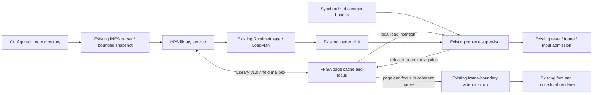
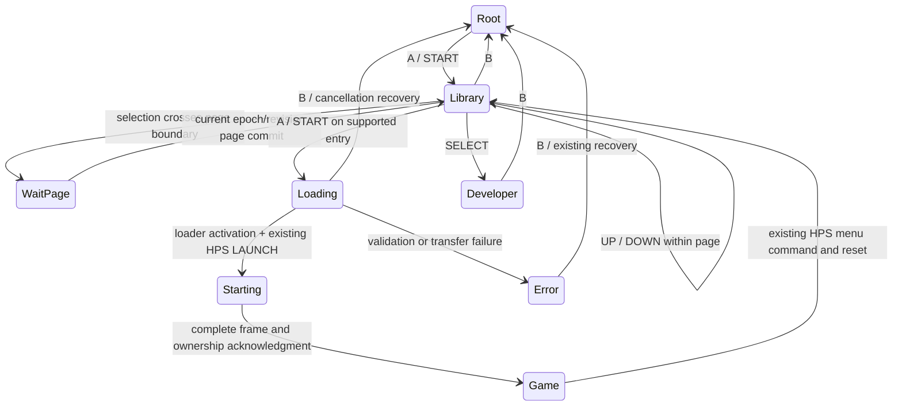

# Phase 8C — Game library and navigation

## Assessment and decision recorded before implementation

Entry commit: `5fdc7877936b18b91c891b117277518fbbe2e2a2`, merged Phase 8B.
A fresh fetch confirmed HEAD, origin/main and the required
`phase8/game-library-navigation` upstream were identical; the tree was clean.
No AGENTS.md was present. README.md and the phase reports are the canonical
roadmap. Phase 8A/8B ownership, Phase 4F-H library, iNES/manifest validation,
loader v1.0, console v1.0, diagnostics v1.3, controller routing, reset/CDC,
FAST/FULL scripts, CI and both qualification projects were reviewed.

The architecture was documented before implementation, and the full baseline
finished before production source changes. Reuse the existing Python library,
parser and cartridge loader; add a four-record FPGA page cache and a separate
library v1.0 MMIO aperture. Extend the existing coherent console video packet,
rather than adding a framebuffer or a second video/loader subsystem.

## Fresh baseline

| Gate | Result |
|---|---|
| Python | **2,443 passed**, 129.25 s |
| Verilator | Complete lint clean; **116 PASS records**, **119 simulation completions** |
| Playable ROM | 300 frames, 297 NMI handlers / DMA transfers / controller polls |
| Debugger | 132 frames, 187 commands and acknowledgments |
| Phase 6G production | 35,588,469 cycles; 52 PPU frames; 13 reset epochs; 155,949 MMIO commands; zero mismatches |
| Default console production | 64,687,115 cycles; 10 reset epochs; 81,950 loader commands |
| Console pixels | 22,118,400 renderer + 2,457,600 actual VGA/HDMI output pixels |
| GitHub baseline | Phase 8B PR #56 FULL check and starting main check successful |

Fresh resource and all-corner timing measurements reproduce Phase 8B:

| Metric | Production VGA/HPS | Logical HDMI/audio |
|---|---:|---:|
| ALMs | 10,901 | 4,274 |
| Registers | 16,315 | 4,842 |
| M10Ks | 275 | 210 |
| Block-memory bits | 2,238,504 | 1,698,344 |
| MLAB bits | 18,880 | 0 |
| DSPs / PLLs | 7 / 2 | 8 / 2 |
| Worst setup / hold (ns) | +1.135 / +0.077 | +0.584 / +0.119 |
| Recovery / removal (ns) | +3.375 / +0.460 | +10.538 / +0.686 |
| Minimum pulse width (ns) | +0.608 | +0.612 |
| TNS | 0 | 0 |
| Synthesis/fitter/assembly/STA warnings | 107/149/0/144 | 23/3/0/0 |

Both complete build scripts passed, including assembly, constrained-path and
nonnegative all-corner slack gates. The fresh production synthesis count is
107, versus 106 in the older published report; use the archived fresh baseline
for comparisons. The known generated HPS DDR `pll_dr_clk` implicit-net warning
remains; production RTL passes the implicit-net gate. Baseline logs, reports,
critical paths and warning inventory are under ignored `build/phase8c/baseline/`.

## Data flow and ownership



HPS discovers and validates files, maintains immutable snapshot identities,
prepares manifests, transfers bytes, and reports named stages/errors. FPGA
logic owns visible focus, paging, disabled-item enforcement, launch requests,
and the existing supervisor's reset/input/video decisions. Numeric indices
refer only to the current HPS snapshot. No paths or ROM bytes cross the library
interface, and the FPGA does not parse ROM files.

| Module/interface | Responsibility |
|---|---|
| `GameLibrary.scan(limit=256)` | Existing discovery with bounded retained names/header reads and recorded file/root identity |
| `library_protocol.py` | Fixed metadata encoding and single-outstanding, bounded MMIO transactions |
| `library_service.py` | Snapshot policy, request claiming, preflight, ownership monitoring around the existing loader |
| `nes_library_mmio` | Separate 64-byte register bank, full-word submission, stable pending request |
| `nes_library_control` | Four-record staging/active banks, page/launch events, focus and revision |
| `nes_console_control` | Existing states plus local library load/cancel intentions; old commands unchanged |
| `nes_console_video` | Existing held-bank handshake expanded from 42 to 970 bits: 42 existing bits + 928 library bits |
| `nes_console_renderer` | Existing registered row/glyph path; four text rows and validated details |

## Discovery, identity and filename safety

The library root is configured with `--library PATH` or `NES_LIBRARY_ROOT`.
Discovery is nonrecursive and matches `.nes` case-insensitively. Existing NFC,
case-folded ordering and exact-filename tie breakers remain. Exact relative
filenames, including spaces and Unicode, are stable HPS identities; titles need
not be unique. The visible position distinguishes duplicate display labels.

The service retains the first 256 eligible files in deterministic order and
shows **FIRST 256 FILES** when truncated. Enumeration is O(N), with bounded
O(256) retained-name memory and at most 256 inspected headers. It does not read
all ROM payloads. The older CLI's unbounded listing remains available; the
console service always supplies the limit.

Files are opened relative to a directory descriptor, with `O_NOFOLLOW` and
regular-file checks. Root device/inode and file device/inode/size/mtime/ctime
are recorded. Launch rejects replaced roots or files and revalidates content.
Header/size validation bounds a full load to supported NROM capacity plus one
byte for growth detection; identity is checked again after reading. Traversal,
absolute/nested selection IDs, symlinks and special files cannot become loads.
No shell interpolation, filesystem writes, ROM downloads or unrestricted path
requests are introduced.

Snapshots are immutable until service restart or bridge/physical reset. Adding
files does not silently retarget a pending selection. Restarting the service
waits for MENU before replacing its binding; it does not steal GAME/Developer
ownership. A missing root is distinct from an empty directory. After mounting
missing media, restart the service to rescan.

Optional `--metadata titles.json` is a maximum 64 KiB JSON object mapping exact
filenames to display-title strings of 1..128 characters (at most 256 mappings).
It cannot override compatibility or manufacture region/playability facts.
Invalid optional metadata is reported on stderr and ignored. Filename stems
are fallback labels only. Titles are uppercased, accent-normalized and clipped
to 24 existing-font characters; unsupported characters become visible dots and
long labels end in `...`. Software retains the original Unicode identity.
The FPGA independently sanitizes unsupported glyph bytes.

NES 2.0 is identified as unsupported, with mapper/capacity details unavailable:
the classic parser's partial NES 2.0 fields are not presented as validated data.
No title is described as verified playable solely from its mapper.

| Cartridge | Console eligibility |
|---|---|
| Classic iNES Mapper 0, NROM-128 / NROM-256 | Supported with the existing strict header/manifest checks |
| Mapper 0, 8 KiB CHR ROM or 8 KiB CHR RAM | Supported within existing storage |
| Mapper 0 with excess PRG/CHR capacity or unsupported flags | Visible, disabled |
| Mapper 1/MMC1, 2/UxROM, 3/CNROM, 4/MMC3 and other mappers | Visible when safely parsable, disabled |
| NES 2.0 | Visible as unsupported format; partial classic fields hidden |
| Corrupt/truncated files | Visible as invalid, disabled |

## Library v1.0 wire contract

`config/library_mmio.json` defines a new aperture at **0xff203000 / 64 bytes**,
magic **0x4e45534c**, version **0x00010000**, limits **0x18040100** (24 title
bytes, four entries/page, 256 entries). Loader v1.0, diagnostics v1.3 and console
v1.0 retain their addresses, spans, versions, command/status semantics and
reserved locations. This is an additive extension, not a console v1.0 rewrite.

| Offset | Meaning |
|---|---|
| 00 / 04 / 08 | Magic / version / fixed limits |
| 0c | bit 0 ready, bit 1 pending, bit 2 rejected submission |
| 10 | COMMAND: epoch[31:16], word index[15:8], opcode[7:0] |
| 14 / 18 | Result (0 OK, 1 STALE, 2 INVALID, 3 UNAVAILABLE) / completion count |
| 1c / 20 / 24 | Coherent pre-command console status / library status / revision |
| 28 / 2c | Write-only staged payload / expected revision |
| 30..3c | Reserved: reads zero, writes ignored |

The 96-bit request holds `{payload, revision, command}` until acknowledged;
the 128-bit response holds `{revision, library status, console status, result}`.
Only full-word writes are admitted. Busy/partial submissions are rejected
without replacing the held request. The next accepted command clears rejection.
The 32-bit completion counter wraps modulo 2^32 and resets with the bridge.

| Opcode | Preconditions and action |
|---|---|
| 0 STATUS | Observation only; ignores submitted epoch/revision |
| 1 BEGIN_PAGE | MENU; disabled library or outstanding page request; bounded total and truncation flag; start a fresh staging transaction |
| 2 WORD | Exact next word index 0..27; metadata validation; title sanitization |
| 3 COMMIT | All 28 words received; publish page atomically; advance revision |
| 4 CLAIM | Current LOADING launch event; consume once, set VALIDATING, advance revision |
| 5 STAGE | Named stage 0 or 2..10; PREPARING/LOADING require LOADING; READY requires MENU and active runtime image |
| 6 DISABLE | MENU/ERROR/DEVELOPER only; invalidate snapshot binding, selection, pending page/request; advance revision |

Every mutation requires the observed 16-bit console epoch and 32-bit library
revision. Navigation or concurrent ownership change rejects mutations as stale.
Incomplete, stale, malformed or out-of-order pages cannot become visible or
launchable. Total/truncation cannot change inside an enabled snapshot: disable
before a rescan. Sequence counters are bounded freshness checks, not persistent
authentication nonces. Physical/bridge reset clears both mailbox endpoints,
metadata, requests and bindings; the host must republish.

Each page has four 28-byte records: 24 title bytes in ascending byte order,
then a little-endian metadata word. Metadata is mapper[7:0], PRG 16 KiB bank
count[15:8], CHR 8 KiB bank count[23:16], kind[25:24] (0 invalid, 1 unsupported,
2 supported), NES2[26], reserved-zero[31:27]. Supported records must additionally
have Mapper 0, PRG count 1/2, CHR count 0/1 and classic format. Zero CHR banks
means the existing 8 KiB CHR RAM. Header compatibility restrictions remain HPS
parser policy; the loader revalidates its manifest as before.

Library status is selected[7:0], total[16:8], event[18:17] (0 none, 1 page,
2 launch), enabled[19], open[20], page-valid[21], stage[25:22], truncated[26],
last-result[30:27], reserved-zero[31]. The 928-bit display packet contains this
header and the four active records. Metadata and focus commit with console
status at the existing raster boundary. HPS/fabric requests use the existing
three-stage held-bank mailbox and finite 20 ns bundled-data routing bounds;
no unsynchronized multi-bit CDC or new clock is introduced.

## Navigation and launch

Root MENU retains UP/DOWN focus and A selection. With an HPS library published,
Play is labeled GAME LIBRARY; A/START opens it. Without the service, the existing
built-in diagnostic cartridge behavior remains. SELECT retains Developer Mode.
Inside the library: UP/DOWN move one entry, LEFT/RIGHT move four (clamped),
A/START request a supported load, B returns to root. A plus a direction selects
the previously focused entry. Page-boundary requests hide stale entries and
wait for the corresponding committed page. Empty/single-entry/end boundaries
are deterministic. Disabled entries remain browsable and emit no launch event.

Held buttons act once, preserving Phase 8B's edge policy. Release-to-arm remains
in the supervisor at every ownership handoff. No mechanical debounce, USB
provider or physical Home control is claimed. GAME passes armed synchronized
buttons directly to the existing NES serial ports, with no added steady-state
latency or reserved gameplay chord.



These are presentation/navigation states around the existing eight-state
supervisor. WaitPage is a library event, not a replacement supervisor state;
all return arrows still use its RETURNING/frame acknowledgment sequence.

A supported local request enters the existing LOADING state and advances its
ownership epoch immediately. HPS claims it, reopens/revalidates the exact file,
prepares the existing `LoadPlan`, and calls `execute_load_plan`. A small wrapper
observes console ownership before BEGIN, at most every 256 payload writes,
before COMMIT/ACTIVATE, and after activation. It does not generate an alternative
loader protocol. BEGIN and ACTIVATE retain their existing epoch/reset behavior.
After activation, HPS waits for the current-epoch MENU acknowledgment, reports
READY, sends the existing LAUNCH, and waits for the GAME frame acknowledgment.
Before READY, it also checks that the library remains open and its revision
matches the one recorded before transfer. B coincident with ACTIVATE shares
the supervisor's single epoch increment; the independent library revision
detects that cancellation even if the user reopens the library before polling.

B cancellation advances ownership even in the ready-to-launch MENU window, so
a late LAUNCH cannot reopen a cancelled selection. Cancelled/stale commands are
discarded, not automatically retried. A stopped host may leave WAITING FOR HPS,
but B and independent recovery remain usable. After writes, interruption or
failure requires a complete reload: the single runtime store has no rollback.
In library mode, a BEGIN retry is evaluated against the loader's next-clock
result, rather than its old ERROR state on the acceptance edge. Valid retries
remain LOADING; rejected retries still report the actual loader error. B wins
over concurrent host/loader intentions in MENU, LOADING and ERROR, including a
cancelled BEGIN's delayed error result. Bridge/physical reset retains priority.
The existing console policy remains unchanged when the library is disabled.
Host stage updates retain the launch epoch; a superseded launch cannot report
an old failure into a newer request. FPGA logic owns cancellation feedback.
Loader v1.0 has no ABORT, and BEGIN while still receiving returns BEGIN_BUSY.
If the next selection finds an abandoned receiving session, the service shows
RECOVERY and submits the existing COMMIT without writing payload or activating.
An incomplete image becomes ERROR; a complete but unactivated image becomes
READY and is still not launched. The user presses B and selects again for a
complete reload. This explicit recovery preserves the loader contract and
avoids automatically replaying a superseded launch.
Return from gameplay uses the existing HPS `menu` command and resets NES
execution; it is not save/resume. A real system/Home input remains deferred.

Stages are idle, validating, preparing, loading, ready, unsupported, invalid or
changed ROM, missing file/library, load failure, interrupted transfer, recovery,
and FPGA-observed GAME admission. There are no percentages. Animated dots are
indeterminate. Existing loader and frame-timeout errors remain meaningful.
Developer Mode preserves its diagnostic panel and adds library count, selected
position, selected mapper and last result in the unused console area. Existing
console status continues to expose loader state/error and ownership state.

## Layout and memory

The existing 640x480 procedural canvas and palette are retained: charcoal
background, purple focus, off-white titles and restrained error/status colors.
Four 24-character rows occupy y=184/216/248/280; selected mapper/PRG and CHR/format
appear below, followed by compatibility/loading status and controls. Bank-size
units are explicit (`X16K`, `X8K`); CHR RAM is shown as 8K. Logical 720p centers
the same unscaled canvas at (320,120). No PPU execution is required for the UI.

Five numeric fields are sampled together and converted to decimal with nine
registered add/shift steps. A changed frame packet is formatted within 20 pixel
clocks, before the first text row at y=40. Row preparation at x=0 and the RGB
output latency remain unchanged. Exhaustive 0..511 formatter checks supplement
the independent frame comparisons. This replaces a measured failing HDMI path
through a combinational divider; timing constraints were not relaxed.

Active title/metadata payload is **112 bytes**, plus a same-size staging bank
and coherent mailbox replication. Cartridge RAM and triple-framebuffer
allocation are preserved. Cover art is not transported and no fake cover
placeholders are shown. A future 96x128 cover is 36 KiB at RGB888, or 6 KiB at
4-bit indexed color before palette/storage overhead. Rich artwork needs an
explicit asset-store and transport budget; it is optional future work.

The standalone HDMI qualification target has a 32-bit word/shift virtual input
feeding a bounded packet register. This prevents constant folding of the new
renderer in timing/resource analysis. Inputs are constrained synchronously to
CLOCK_50. It is a test harness, not a production controller, asset protocol,
physical HDMI port or Phase 8D adaptation.

## Running the service

```sh
export NES_LIBRARY_ROOT=/media/microsd/games
python3 -m software.nes_console serve
# Optional presentation titles:
python3 -m software.nes_console serve --library /media/games --metadata titles.json
# Existing commands remain usable between service polling transactions:
python3 -m software.nes_console menu
python3 -m software.nes_console developer
```

The service uses the existing `/dev/mem` transports and exclusive console lock.
It releases the lock between polling steps and holds it for a complete launch.
Raw MMIO writers and older tools that ignore the lock still require system-level
serialization. Linux image, mount permissions, bridge enabling and real USB
input remain physical bring-up prerequisites, not simulated Linux success.

## Qualification status

The local software, lint and simulation qualification passed **2,528 Python
tests**, **122 PASS records** and **121 simulation completions**, compared with
2,443 / 116 / 119 at baseline. All existing suites are retained, with added
library software, MMIO/navigation, pixel and production-top cases. RTL replay uses real
software-discovered metadata and original generated ROMs; it does not execute
an HPS Linux kernel. PNGs are converted from actual simulated RGB dumps, not
manually drawn mockups.

The complete FULL workflow passed stages 1–5, including 300 playable frames,
297 NMI/DMA/controller polls, the 132-frame debugger run and the unchanged
35,588,469-cycle Phase 6G production regression with zero mismatches. After the
last library-only BEGIN/cancellation fix, stage 6 was rebuilt and rerun through
`scripts/test_console.sh`, and complete lint was rerun successfully. The totals
above combine those passed stages; they do not represent one uninterrupted
local FULL invocation. The PR workflow runs the complete FULL script on the
submitted commit. Local evidence is in `build/phase8c/qualified-full.log`,
`qualified-console.log`, `qualified-all-stages.log` and `recovery-final-lint.log`.
The final host activation-cancellation guard was additionally qualified by the
complete Python suite (`final-python.log`) and the directed supervisor
arbitration bench (`activation-control.log`); it does not change production RTL.

The final default-production simulation passed **89,047,680 cycles**, **13 reset
epochs** and **131,173 loader commands**. It retained the Phase 8A/8B scenarios,
then exercised discovered pages, unsupported/corrupt selection, paging,
partial-transfer cancellation and closure, two complete library launches,
generated NROM CPU signatures, release-to-arm and fresh NES controller polling,
menu/Developer return and bridge-reset invalidation. Audio FIFO under/overrun
counters remained zero. Actual production library output matched **307,200 VGA
pixels and 921,600 logical HDMI pixels**, in addition to the retained 2,457,600
console/splash output pixels.

The local FAST gate passed before the final two host-race cases: **2,526 Python
tests**, clean Verilator lint,
**25 PASS records / 30 simulation completions**, retained Phase 8B pixels, all
512 numeric formatter inputs and **18,432,000** exact library pixels. The new
85 Python cases are additional to the measured 2,443-test baseline.

Both complete Quartus flows passed synthesis, fitting, assembly, all-corner
timing and explicit renderer/path reports. Production also generated the RBF.
No timing constraint was relaxed. Production results:

| Metric | Phase 8B baseline | Phase 8C production |
|---|---:|---:|
| ALMs | 10,901 | 14,012 (+3,111) |
| Registers | 16,315 | 22,488 (+6,173) |
| M10Ks / block-memory bits | 275 / 2,238,504 | 275 / 2,238,504 |
| MLAB bits | 18,880 | 18,880 |
| DSPs / PLLs | 7 / 2 | 7 / 2 |
| Worst setup / hold (ns) | +1.135 / +0.077 | +0.905 / +0.063 |
| Recovery / removal (ns) | +3.375 / +0.460 | +3.375 / +0.449 |
| Minimum pulse width (ns) | +0.608 | +0.608 |
| TNS | 0 | 0 |
| Synthesis/fitter/assembly/STA warnings | 107/149/0/144 | 106/149/0/144 |

Production uses 44% of ALMs and retains the existing 69% M10K occupancy. The
additional registers implement the two small page banks, coherent display
replicas, separate MMIO/mailbox and decimal formatting. Bounding row selection
to four explicit title choices avoids an oversized variable title selector.
The limiting setup path remains at a VGA output: baseline `content_blocked`
to `VGA_B[4]`, final `selected_source[0]` to `VGA_G[3]`. Explicit renderer
row/RGB setup slacks are +21.604/+17.137 ns. The final +0.063 ns fast-corner
hold limit is `diagnostics|ppu_frames[10]` to `snapshot_source_bank[11][10]`;
the baseline limit was in the generated HPS DDR hard PHY.

After the final recovery-control fix, placement seed 1 missed setup by
0.038 ns (TNS -0.038 ns), on the existing `video|output_active` to `VGA_G[0]`
output mux. The archived path has two logic levels and substantial routing
delay to the pin. Production now explicitly uses deterministic fitter seed 2;
its full build passes all corners with unchanged RTL, clocks, output latency
and timing constraints. Failed reports are retained in
`build/phase8c/production-timing-candidate/`; the passing build log is
`build/phase8c/fit/production-seed2.log`.

Production fitter/assembly/STA warning messages match the normalized baseline.
Synthesis no longer reports the generated HPS QSEQ dangling-pin warning. The
existing generated traffic-limiter truncation warning now names a four-bit
input rather than three bits, consistent with the fourth MMIO slave. The known
generated DDR `pll_dr_clk` implicit-net warning remains; there are no implicit
nets in production RTL, inferred latches, multiple-driver or critical warnings.
Passing production reports are archived under
`build/phase8c/qualified/production-reports/`.

Logical HDMI results:

| Metric | Phase 8B baseline | Phase 8C logical HDMI |
|---|---:|---:|
| ALMs | 4,274 | 6,048 (+1,774) |
| Registers | 4,842 | 8,843 (+4,001) |
| M10Ks / block-memory bits | 210 / 1,698,344 | 210 / 1,698,344 |
| MLAB bits | 0 | 0 |
| DSPs / PLLs | 8 / 2 | 8 / 2 |
| Worst setup / hold (ns) | +0.584 / +0.119 | +0.448 / +0.121 |
| Recovery / removal (ns) | +10.538 / +0.686 | +9.121 / +0.631 |
| Minimum pulse width (ns) | +0.612 | +0.612 |
| TNS | 0 | 0 |
| Synthesis/fitter/assembly/STA warnings | 23/3/0/0 | 23/3/0/0 |

The complete HDMI build script passed, including assembly and fully constrained
setup/hold gates. The limiting setup path remains pixel reset to an HDMI RGB output
(`HDMI_RGB[14]` in the final fit). Renderer row preparation is +2.691 ns and
renderer RGB preparation is +1.377 ns in the explicit path reports. The final
fast-corner hold limit is a framebuffer write-address register path; the
baseline limit was in the audio accumulator.
Normalized warning messages are unchanged; there are no critical warnings.

The first HDMI candidate failed: worst all-corner setup was -3.171 ns, with
-84.967 ns endpoint TNS in its worst clock/corner. The inspected 85 C path was
library-count data through a divider to `line_text`. Registered decimal
conversion removed that divider, reduced the candidate from 7,667 to 7,301
ALMs, and closed timing without constraint changes. Narrowing the row selector
to two bits and explicitly selecting one of four titles then removed another
1,253 ALMs, producing the final 6,048-ALM fit. Candidate reports are
retained under ignored `build/phase8c/hdmi-timing-candidate/`; passing reports
are archived under `build/phase8c/qualified/hdmi-reports/`.

The HDMI resource increase includes the 928-bit virtual-input qualification
register and the larger coherent metadata banks, in addition to rendering.
The complete target uses 19% of ALMs. Fixed four-entry storage keeps this bounded;
neither cartridge RAM nor framebuffer allocations increased. Converting this
small, multi-reader page to M10Ks would add ports/serialization and consume the
more constrained block-memory budget, so this phase retains registers.

| Verification layer | New coverage |
|---|---|
| Python (85 new cases) | Bounded directory discovery, deterministic retention, Unicode/long labels, immutable identities, root/file replacement, symlinks, sparse oversized files, mapper/capacity combinations, optional metadata, protocol version/counters/timeouts/reset, repeated loader orchestration, abandoned-session recovery and cancellation races |
| Actual MMIO + asynchronous mailbox | Full-word/busy rejection, reserved locations, stale epoch/revision, interrupted reset, ordered staging and atomic page commit |
| Navigation/supervisor | Empty/single/multiple entries, boundaries, page requests, unsupported rejection, held input, launch claim, valid/rejected BEGIN after ERROR, B versus host/loader intentions and delayed results, ready-window LAUNCH cancellation and retained SELECT behavior |
| Production renderer + coherent 720p overlay | 20 fixtures; normal/reduced-motion output, focus, 256-entry boundary, clipping, unsupported/NES2, named loading/error stages, reset and mid-frame packet stability |
| Production-top sequence | Existing scenarios retained, then software-generated library pages, invalid/unsupported selection, paging, partial-transfer cancellation, two complete real loader launches, CPU signature, fresh released/pressed controller polling, menu/Developer return and bridge-reset invalidation |

The new pixel oracle uses independent literal geometry/palette and the existing
independent font model. It does not extract renderer decisions from RTL.
Software orchestration tests use the existing contract-enforcing loader model;
the production-top bench separately replays real loader command traces through
the actual MMIO/mailbox/store and executes the generated NROM. This combination
does not claim execution of the Python service inside a simulated HPS processor.

## Deferred physical checklist and next phase

All physical items remain **pending**:

1. Boot the qualified SOF/RBF on DE1-SoC and record board/bitstream hashes.
2. Boot HPS Linux, enable the bridge, mount microSD and run discovery/service.
3. Check Unicode/spaced filenames, missing media, permissions and rescan policy.
4. Supply a separately qualified USB gamepad provider; verify navigation,
   release-to-arm, held input and a future physical system/Home control.
5. Inspect VGA and an external VGA-to-HDMI converter for readability/overscan.
6. Load owned NROM128/NROM256/CHR-RAM games and check execution and audio.
7. Repeat menu return, relaunch, Developer Mode and interrupted-load recovery.
8. Confirm partial writes require a complete reload and do not imply rollback.

Phase 8D must preserve the metadata, input and frame-ownership contracts while
qualifying display adaptation. Phase 8E controller pairing, Phase 7B mapper
expansion and external SDRAM remain deferred. Mapper 0 alone is supported;
Mapper 1/MMC1, 2/UxROM, 3/CNROM and 4/MMC3 remain visible as unsupported.
